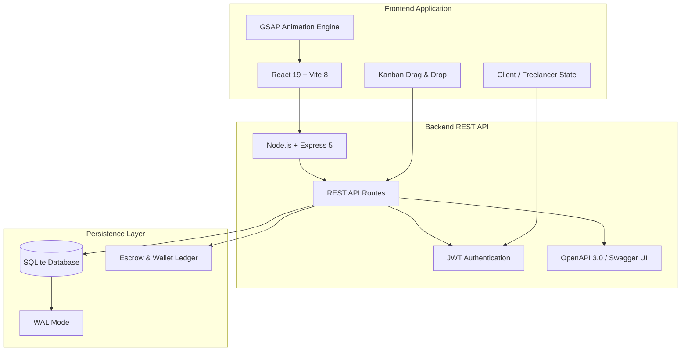

<div align="center">

  

  <h1>🟠 WORKVERSE</h1>
  <h3>Where Talent Meets Opportunity.</h3>

  <p>
    <strong>A Unified Freelance Marketplace &amp; Project Management Workspace</strong>
  </p>

  <p>
    Discover talent. Find meaningful work. Manage projects, conversations,
    deliverables, and escrow workflows — all in one place.
  </p>

  <p>
    <a href="#-overview">Overview</a> •
    <a href="#-features">Features</a> •
    <a href="#-tech-stack">Tech Stack</a> •
    <a href="#-getting-started">Getting Started</a> •
    <a href="#-api-documentation">API Docs</a>
  </p>

  <br />

  
  
  
  
  
  
  
  

  <br /><br />

  <table>
    <tr>
      <td align="center"><strong>🔍 DISCOVER</strong><br />Find the right talent and opportunities.</td>
      <td align="center"><strong>🤝 COLLABORATE</strong><br />Work together in one connected workspace.</td>
      <td align="center"><strong>🚀 DELIVER</strong><br />Track milestones, files, and payments.</td>
    </tr>
  </table>

</div>

---

## 📑 Table of Contents

<details open>
  <summary><strong>Explore Workverse</strong></summary>

  - [🌐 Overview](#-overview)
  - [✨ Features](#-features)
  - [🧩 Platform Modules](#-platform-modules)
  - [🏗️ Architecture](#️-architecture)
  - [🔐 User Roles](#-user-roles)
  - [🛠️ Tech Stack](#️-tech-stack)
  - [⚙️ Getting Started](#️-getting-started)
  - [📡 API Documentation](#-api-documentation)
  - [🧪 Testing & Build](#-testing--build)
  - [📂 Project Structure](#-project-structure)
  - [🏁 Release v1.0.0](#-release-v100)
  - [🗺️ Roadmap](#️-roadmap)
  - [🤝 Contributing](#-contributing)

</details>

---

## 🌐 Overview

**Workverse** is a modern freelance marketplace and project management platform built to bring clients and freelancers together through a unified digital workspace.

From discovering skilled professionals and finding projects to managing proposals, conversations, deliverables, milestones, and financial workflows, Workverse brings the freelance journey into one connected experience.

<div align="center">
  <h3>One workspace. Every stage of freelance collaboration.</h3>
  <p><em>Find talent → Start a project → Collaborate → Deliver work → Track payments</em></p>
</div>

### Our Core Philosophy

<table>
  <tr>
    <td width="33%" align="center">
      <h3>🔍 Discover</h3>
      <p>Explore freelancer profiles, portfolios, skills, and meaningful project opportunities.</p>
    </td>
    <td width="33%" align="center">
      <h3>🤝 Collaborate</h3>
      <p>Manage proposals, projects, conversations, teams, and deliverables in one place.</p>
    </td>
    <td width="33%" align="center">
      <h3>💼 Manage</h3>
      <p>Keep track of milestones, working hours, escrow balances, payments, and progress.</p>
    </td>
  </tr>
</table>

---

## ✨ Features

<table>
  <tr>
    <td width="50%">
      <h3>🎨 Modern Interface</h3>
      <p>Responsive UI with a premium Warm Ivory, Architectural Orange, and Charcoal design system.</p>
    </td>
    <td width="50%">
      <h3>🔎 Talent Discovery</h3>
      <p>Explore freelancer profiles and portfolios with search, filters, pagination, and messaging.</p>
    </td>
  </tr>
  <tr>
    <td>
      <h3>💻 Work Discovery</h3>
      <p>Browse project opportunities, review scopes, and submit proposals.</p>
    </td>
    <td>
      <h3>📊 Project Management</h3>
      <p>Track projects, milestones, Kanban tasks, and overall progress.</p>
    </td>
  </tr>
  <tr>
    <td>
      <h3>💬 Communication</h3>
      <p>Connect through interactive messaging and workspace conversations.</p>
    </td>
    <td>
      <h3>📁 Deliverables</h3>
      <p>Manage project files, upload metadata, and download interactions.</p>
    </td>
  </tr>
  <tr>
    <td>
      <h3>💰 Escrow &amp; Payments</h3>
      <p>Track balances, manage escrow, and release milestone payments.</p>
    </td>
    <td>
      <h3>📚 Knowledge Base</h3>
      <p>Explore searchable articles, guides, resources, and playbooks.</p>
    </td>
  </tr>
  <tr>
    <td>
      <h3>⚡ Command Palette</h3>
      <p>Navigate quickly with <code>Ctrl + K</code> or <code>Cmd + K</code>.</p>
    </td>
    <td>
      <h3>🎬 Motion &amp; Interactions</h3>
      <p>Enjoy smooth interface transitions powered by GSAP.</p>
    </td>
  </tr>
</table>

---

## 🧩 Platform Modules

### 1. Find Talent

A dedicated space to discover and connect with skilled professionals.

- Browse freelancer profiles and portfolios.
- Search and filter candidates.
- Explore experience and project history.
- View ratings, reviews, and skills.
- Start conversations through messaging interfaces.

### 2. Find Work

A project discovery experience for freelancers.

- Browse available freelance projects.
- Search and filter opportunities.
- Inspect project descriptions and scopes.
- Review milestone-based payment breakdowns.
- Submit project proposals.

### 3. Projects Hub

The Projects Hub brings key project workflows together.

| Module | What it helps you do |
|---|---|
| 📂 Projects Directory | Create projects, track progress, and filter by status. |
| 📝 Proposals Manager | Review proposals, inspect bids, and accept submissions. |
| 💬 Live Messages | Use an interactive split-pane messaging interface. |
| 📁 Deliverables Drive | Manage project files and deliverable metadata. |
| 👥 Squad & Team Roster | Manage team members, roles, permissions, and invitations. |
| 💳 Escrow Financials | Monitor escrow balances, release payments, and manage receipts. |
| ⚙️ Workspace Settings | Configure security preferences and notification settings. |

### 4. Pricing & Resources

- Pricing plans with INR, USD, and EUR currency options.
- Monthly and annual billing selection.
- Interactive FAQ accordion.
- Searchable knowledge base.
- Articles, guides, and playbooks.
- Category-based resource filtering.

### 5. Global Command Palette

Quickly navigate across platform areas without moving through multiple pages.

| Operating System | Shortcut |
|---|---|
| Windows / Linux | `Ctrl + K` |
| macOS | `Cmd + K` |

---

## 🏗️ Architecture

Workverse follows a decoupled frontend, backend, and persistence architecture.

The React application communicates with the Express REST API. The backend handles authentication, business logic, database operations, and platform workflows.

### System Architecture



### Engineering Overview

| Layer | Implementation |
|---|---|
| Frontend | React 19 |
| Build System | Vite 8 |
| Backend | Node.js + Express 5 |
| Authentication | JWT Bearer Token |
| Database | SQLite |
| Database Mode | Write-Ahead Logging (WAL) |
| API Documentation | OpenAPI 3.0 + Swagger UI |
| Animations | GSAP |
| Version Control | Git & GitHub |

---

## 🔐 User Roles

Workverse supports two primary platform personas.

<table>
  <tr>
    <td width="50%" align="center">
      <h3>🧑‍💼 Client</h3>
      <p>Creates projects, manages budgets, reviews deliverables, and handles escrow workflows.</p>
    </td>
    <td width="50%" align="center">
      <h3>👩‍💻 Freelancer</h3>
      <p>Discovers projects, submits proposals, manages tasks, and handles deliverables.</p>
    </td>
  </tr>
</table>

| Functionality | Client | Freelancer |
|---|:---:|:---:|
| Project Creation | ✅ | — |
| Project Discovery | ✅ | ✅ |
| Proposal Submission | — | ✅ |
| Proposal Review | ✅ | — |
| Milestone Management | ✅ | ✅ |
| Deliverable Review | ✅ | — |
| Deliverable Upload | — | ✅ |
| Team Collaboration | ✅ | ✅ |
| Escrow Management | ✅ | ✅ |
| Portfolio Management | — | ✅ |

<sub><em>Availability of individual operations is subject to backend authorization and application policies.</em></sub>

---

## 🛠️ Tech Stack

<div align="center">
  <table>
    <tr>
      <th>Category</th>
      <th>Technology</th>
    </tr>
    <tr><td>Frontend</td><td>React.js, JavaScript</td></tr>
    <tr><td>Build Tool</td><td>Vite</td></tr>
    <tr><td>Styling</td><td>CSS</td></tr>
    <tr><td>Animation</td><td>GSAP</td></tr>
    <tr><td>Backend</td><td>Node.js, Express 5</td></tr>
    <tr><td>Database</td><td>SQLite (WAL Mode)</td></tr>
    <tr><td>Authentication</td><td>JWT</td></tr>
    <tr><td>API Documentation</td><td>OpenAPI 3.0, Swagger UI</td></tr>
    <tr><td>Package Manager</td><td>npm</td></tr>
    <tr><td>Version Control</td><td>Git, GitHub</td></tr>
  </table>
</div>

### Design System

<div align="center">
  <table>
    <tr>
      <td align="center">
        <div style="width:110px;height:42px;background:#FFF9F5;border:1px solid #ddd;border-radius:8px;"></div>
        <strong>Warm Ivory</strong><br /><code>#FFF9F5</code>
      </td>
      <td align="center">
        <div style="width:110px;height:42px;background:#F36B21;border-radius:8px;"></div>
        <strong>Architectural Orange</strong><br /><code>#F36B21</code>
      </td>
      <td align="center">
        <div style="width:110px;height:42px;background:#171717;border-radius:8px;"></div>
        <strong>Charcoal</strong><br /><code>#171717</code>
      </td>
    </tr>
  </table>
</div>

---

## ⚙️ Getting Started

Follow these steps to run Workverse locally.

### ⚡ Unified Quick Start (Recommended)

From the project root, launch both the Express backend API and Vite frontend client concurrently:

```bash
# 1. Install dependencies
npm --prefix backend install
npm --prefix frontend install

# 2. Start full-stack development environment concurrently
npm run dev
```

- **Client Web App**: [http://localhost:5173](http://localhost:5173)
- **REST API & Swagger Docs**: [http://localhost:5000/api](http://localhost:5000/api)

Run the automated platform test suite (39 automated checks):

```bash
npm test
```

### 🐳 Run with Docker & Docker Compose

Workverse includes a production multi-stage container configuration:

```bash
# Build and run the containerized platform
docker compose up --build
```

---

### Prerequisites

Make sure you have installed:

- [Node.js](https://nodejs.org/) v18 or higher
- npm v9 or higher
- [Git](https://git-scm.com/)

### 1. Clone the Repository

```bash
git clone https://github.com/rasesh13/freelance-project-axlero.git
cd freelance-project-axlero
```

### 2. Setup the Backend

Open a terminal from the project root:

```bash
cd backend
npm install
npm start
```

Backend server:

```text
http://localhost:5000
```

### 3. Setup the Frontend

Open a second terminal from the project root:

```bash
cd frontend
npm install
npm run dev
```

Frontend development server:

```text
http://localhost:5173
```

### 4. Verify Backend Health

Use a browser or PowerShell:

```powershell
Invoke-RestMethod http://localhost:5000/api/health
```

A successful response confirms that the backend health endpoint is reachable.

### 5. Backend Resources

| Resource | Local URL |
|---|---|
| Backend | `http://localhost:5000` |
| Swagger UI | `http://localhost:5000/docs` |
| OpenAPI JSON | `http://localhost:5000/openapi.json` |
| Health Check | `http://localhost:5000/api/health` |

---

## 📡 API Documentation

Workverse exposes REST APIs for core platform functionality. Interactive API documentation is available through Swagger UI.

**API Base URL**

```text
http://localhost:5000/api
```

<details open>
  <summary><strong>❤️ Health & Authentication</strong></summary>

  | Method | Endpoint | Description | Authentication |
  |---|---|---|---|
  | GET | `/api/health` | Server and database health | No |
  | GET | `/api/stats` | Platform statistics | No |
  | POST | `/api/auth/login` | User authentication | No |
  | POST | `/api/auth/register` | Account registration | No |
  | GET | `/api/auth/me` | Current authenticated profile | Bearer |
</details>

<details>
  <summary><strong>📁 Projects & Kanban</strong></summary>

  | Method | Endpoint | Description | Authentication |
  |---|---|---|---|
  | GET | `/api/projects` | Retrieve projects | No |
  | POST | `/api/projects` | Create a project | No |
  | GET | `/api/projects/:id` | Retrieve project details | No |
  | DELETE | `/api/projects/:id` | Delete a project | No |
  | GET | `/api/kanban` | Retrieve Kanban tasks | Bearer |
  | POST | `/api/kanban` | Create a task | Bearer |
  | PATCH | `/api/kanban/:id/column` | Update task column | Bearer |
  | DELETE | `/api/kanban/:id` | Delete a task | Bearer |
</details>

<details>
  <summary><strong>💳 Files, Wallet & Payments</strong></summary>

  | Method | Endpoint | Description | Authentication |
  |---|---|---|---|
  | GET | `/api/files` | Retrieve project files | Bearer |
  | POST | `/api/files` | Register deliverable metadata | Bearer |
  | DELETE | `/api/files/:id` | Delete a deliverable | Bearer |
  | GET | `/api/wallet` | Retrieve wallet information | Bearer |
  | POST | `/api/wallet/withdraw` | Submit withdrawal request | Bearer |
  | POST | `/api/time/log` | Record billable time | Bearer |
  | GET | `/api/payments` | Retrieve payment records | Bearer |
  | PATCH | `/api/payments/:id/release` | Release milestone payment | Bearer |
</details>

<details>
  <summary><strong>🤝 Contracts, Proposals, Messages & Settings</strong></summary>

  | Method | Endpoint | Description | Authentication |
  |---|---|---|---|
  | GET | `/api/contracts` | Retrieve contracts | Bearer |
  | GET | `/api/proposals` | Retrieve proposals | Bearer |
  | GET | `/api/messages` | Retrieve conversations | Bearer |
  | POST | `/api/messages` | Send a message | Bearer |
  | GET | `/api/search` | Search platform resources | No |
  | GET | `/api/settings` | Retrieve settings | No |
  | PUT | `/api/settings` | Update settings | No |
</details>

> **Note:** Verify endpoint availability and authentication requirements against the current backend implementation and OpenAPI specification.

---

## 🧪 Testing & Build

Workverse includes backend test commands for API integration, database checks, and health verification.

### Run Backend Tests

```bash
# Complete test suite
npm test --prefix backend

# API integration tests
npm run test:api --prefix backend

# Database tests
npm run test:db --prefix backend

# Backend health verification
npm run test:health --prefix backend
```

### Build Frontend

```bash
cd frontend
npm install
npm run build
```

The production build output is generated in:

```text
frontend/dist
```

### Reported Test Coverage

| Test Category | Reported Coverage |
|---|---|
| API Integration | 26 end-to-end tests |
| Database Audit | 13 integrity and WAL checks |
| Health Verification | Backend health endpoint |

<sub><em>Test counts and build results should be updated whenever the test suite or implementation changes.</em></sub>

---

## 📂 Project Structure

```text
freelance-project-axlero/
│
├── backend/
│   ├── dashboard.js
│   ├── db.js
│   ├── openapi.js
│   ├── server.js
│   ├── package.json
│   └── package-lock.json
│
├── frontend/
│   ├── public/
│   ├── src/
│   │   ├── api/
│   │   ├── components/
│   │   ├── pages/
│   │   │   └── ProjectsHubPage.jsx
│   │   ├── App.jsx
│   │   └── main.jsx
│   ├── package.json
│   ├── package-lock.json
│   └── vite.config.js
│
├── docs/
└── README.md
```

---

## 🏁 Release v1.0.0

**Workverse v1.0.0** represents the first documented milestone release of the platform.

<details open>
  <summary><strong>🗓️ Development Timeline</strong></summary>

  | Day | Milestone |
  |---|---|
  | 01 | Design system, UI palette, GSAP animations, and responsive navigation. |
  | 02 | Find Talent and Find Work modules. |
  | 03 | Interactive Kanban board, time tracker, and project setup wizard. |
  | 04 | Express REST API, SQLite persistence, and Swagger documentation. |
  | 05 | Unified application architecture, JWT authentication, and user personas. |
  | 06 | Projects Hub, escrow wallet, and dashboard analytics. |
  | 07 | Milestone delivery board and drag-and-drop functionality. |
  | 08 | Task checklists, messaging, and dispute workflows. |
  | 09 | Automated testing and database integrity verification. |
  | 10 | Architecture documentation, API reference, and v1.0.0 release preparation. |
  | 11 | CI/CD GitHub Actions pipeline, Docker containerization, root monorepo scripts, and backend security hardening. |
</details>

### Release Checklist

- [x] Frontend production build
- [x] Backend REST API implementation
- [x] JWT authentication
- [x] SQLite persistence
- [x] Projects and Kanban workflows
- [x] API documentation
- [x] Backend integration testing
- [x] Database integrity checks
- [x] Developer documentation
- [x] Multi-stage Docker containerization & Docker Compose orchestration
- [x] GitHub Actions automated CI matrix pipeline
- [x] Root monorepo development scripts (`npm run dev`)
- [x] Backend security headers & graceful shutdown lifecycle

---

## 🗺️ Roadmap

Potential areas for future development:

- [ ] Real-time messaging and notifications
- [ ] Advanced project analytics and reporting
- [ ] Secure payment gateway integration
- [ ] Enhanced file sharing and collaboration
- [ ] Automated project workflow management
- [ ] Improved freelancer discovery and recommendations
- [ ] Expanded dashboard customization

---

## 🤝 Contributing

Contributions, ideas, and feedback are welcome.

1. Fork the repository.
2. Create a feature branch: `git checkout -b feature/your-feature`
3. Commit your changes: `git commit -m "feat: add your feature"`
4. Push your branch: `git push origin feature/your-feature`
5. Open a Pull Request.

Please keep changes focused and make sure the application builds before submitting a pull request.

---

<div align="center">

  <h2>🟠 WORKVERSE</h2>
  <h3>Where Talent Meets Opportunity.</h3>

  <p><strong>Discover. Collaborate. Deliver.</strong></p>

  <p>
    A unified workspace built to empower freelancers, connect businesses,
    and simplify project management.
  </p>

  <br />

  <strong>Built with ❤️ by the Workverse Development Team</strong>

  <br /><br />

  <sub>© Workverse — All rights reserved.</sub>

</div>
