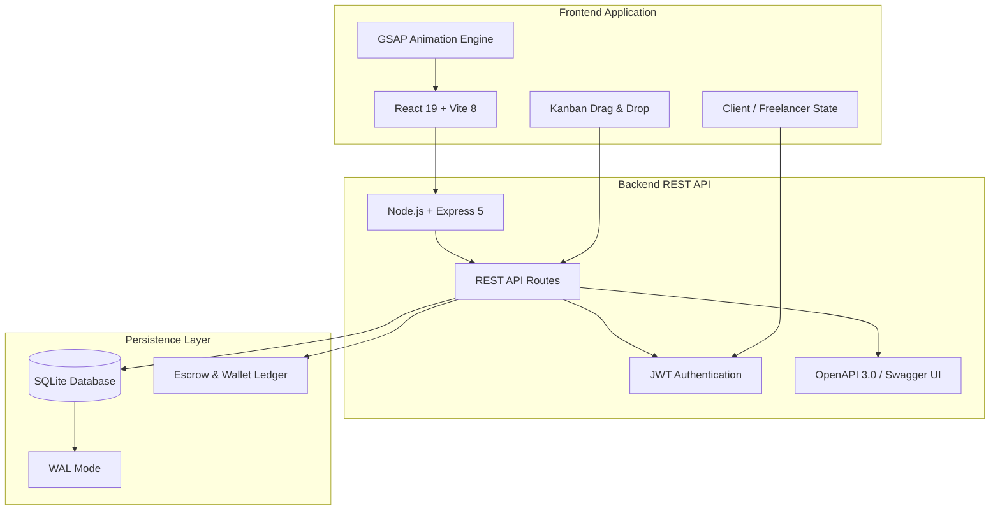

\<div align="center">

# 🟠 WORKVERSE

### Where Talent Meets Opportunity.

**A Unified Freelance Marketplace & Project Management Workspace**

Discover talent. Find meaningful work. Manage projects, conversations, deliverables, and escrow workflows — all in one place.

\<br/>


\


\<br/>

**Warm Ivory** `#FFF9F5`   •  
**Architectural Orange** `#F36B21`   •  
**Charcoal** `#171717`

\<br/>

**Discover · Collaborate · Deliver**

\</div>

---

## 📑 Table of Contents

\<details open>
\<summary>\<strong>Explore Workverse Documentation\</strong>\</summary>

- [Overview](#overview)
- [Platform Highlights](#platform-highlights)
- [Platform Modules](#platform-modules)
- [Architecture](#architecture)
- [Role-Based Access](#role-based-access)
- [Technology Stack](#technology-stack)
- [Getting Started](#getting-started)
- [API Documentation](#api-documentation)
- [Testing & Production Build](#testing--production-build)
- [Project Structure](#project-structure)
- [Release v1.0.0](#release-v100)
- [Roadmap](#roadmap)

\</details>

---

## 🌐 Overview

**Workverse** is a modern freelance marketplace and project management platform designed to connect clients and freelancers through a unified digital workspace.

It brings talent discovery, project opportunities, collaboration, communication, deliverable management, and financial tracking into one connected ecosystem.

Built with a modern React frontend and a Node.js backend, Workverse focuses on delivering an intuitive, responsive, and efficient experience.

### Our Core Philosophy

\<table>
\<tr>
\<td width="33%" align="center">

### 🔍 Discover

Find talented freelancers, explore portfolios, and discover meaningful project opportunities.

\</td>
\<td width="33%" align="center">

### 🤝 Collaborate

Manage proposals, projects, conversations, teams, and deliverables.

\</td>
\<td width="33%" align="center">

### 💼 Manage

Track milestones, working hours, escrow balances, payments, and project progress.

\</td>
\</tr>
\</table>

---

## ✨ Platform Highlights

| Feature               | Description                                                                     |
| --------------------- | ------------------------------------------------------------------------------- |
| 🎨 Modern UI          | Responsive interface with a premium ivory, orange, and charcoal design system.  |
| 🔎 Talent Discovery   | Freelancer profiles, advanced search, filters, pagination, and messaging.       |
| 💻 Work Discovery     | Browse projects, inspect project scopes, and submit proposals.                  |
| 📊 Project Management | Project tracking, milestone management, Kanban boards, and progress monitoring. |
| 💬 Communication      | Interactive messaging and workspace conversations.                              |
| 📁 Deliverables       | Manage project files, upload metadata, and download interactions.               |
| 💰 Escrow & Payments  | Track balances, manage escrow, and release milestone payments.                  |
| 📚 Knowledge Base     | Searchable articles, guides, resources, and playbooks.                          |
| ⚡ Command Palette     | Quick navigation using `Ctrl + K` or `Cmd + K`.                                 |
| 🎬 Animations         | Smooth interface transitions powered by GSAP.                                   |

---

## 🚀 Platform Modules

### 1. Find Talent

Discover and connect with skilled professionals.

- Browse freelancer profiles and portfolios.
- Search and filter candidates.
- Explore freelancer experience and project history.
- View ratings, reviews, and skills.
- Start conversations through messaging interfaces.

### 2. Find Work

A dedicated space for freelancers to discover opportunities.

- Browse available freelance projects.
- Search and filter opportunities.
- Inspect project descriptions and scopes.
- Review milestone-based payment breakdowns.
- Submit project proposals.

### 3. Projects Hub

The Projects Hub combines seven connected project management modules.

| Module                 | Capabilities                                                    |
| ---------------------- | --------------------------------------------------------------- |
| 📂 Projects Directory  | Create projects, track progress, and filter by status.          |
| 📝 Proposals Manager   | Review proposals, inspect bids, and accept submissions.         |
| 💬 Live Messages       | Interactive split-pane messaging interface.                     |
| 📁 Deliverables Drive  | Manage project files and deliverable metadata.                  |
| 👥 Squad & Team Roster | Manage team members, roles, permissions, and invitations.       |
| 💳 Escrow Financials   | Monitor escrow balances, release payments, and manage receipts. |
| ⚙️ Workspace Settings  | Configure security preferences and notification settings.       |

### 4. Pricing & Resources

- Pricing plans with INR, USD, and EUR currency options.
- Monthly and annual billing selection.
- Interactive FAQ accordion.
- Searchable knowledge base.
- Articles, guides, and playbooks.
- Category-based resource filtering.

### 5. Global Command Palette

Workverse includes a universal command palette for quick navigation.

| Operating System | Shortcut   |
| ---------------- | ---------- |
| Windows / Linux  | `Ctrl + K` |
| macOS            | `Cmd + K`  |

Search across talent, projects, and resources without navigating through multiple pages.

---

## 🏗️ Architecture

Workverse follows a decoupled frontend, backend, and persistence architecture.

The React application communicates with the Express REST API, while the backend manages authentication, business logic, database operations, and financial workflows.

### System Architecture



### Engineering Overview

| Layer             | Implementation            |
| ----------------- | ------------------------- |
| Frontend          | React 19                  |
| Build System      | Vite 8                    |
| Backend           | Node.js + Express 5       |
| Authentication    | JWT Bearer Token          |
| Database          | SQLite                    |
| Database Mode     | Write-Ahead Logging (WAL) |
| API Documentation | OpenAPI 3.0 + Swagger UI  |
| Animations        | GSAP                      |
| Version Control   | Git & GitHub              |

---

## 🔐 Role-Based Access

Workverse supports two primary platform personas.

- **Client:** Creates projects, manages budgets, reviews deliverables, and handles escrow workflows.
- **Freelancer:** Discovers projects, submits proposals, manages tasks, and handles deliverables.

| Functionality        | Client | Freelancer |
| -------------------- | :----: | :--------: |
| Project Creation     |    ✅   |      —     |
| Project Discovery    |    ✅   |      ✅     |
| Proposal Submission  |    —   |      ✅     |
| Proposal Review      |    ✅   |      —     |
| Milestone Management |    ✅   |      ✅     |
| Deliverable Review   |    ✅   |      —     |
| Deliverable Upload   |    —   |      ✅     |
| Team Collaboration   |    ✅   |      ✅     |
| Escrow Management    |    ✅   |      ✅     |
| Portfolio Management |    —   |      ✅     |

*Availability of individual operations is subject to backend authorization and application policies.*

---

## 🛠️ Technology Stack

\<table>
\<tr>
\<th>Category\</th>
\<th>Technology\</th>
\</tr>
\<tr>
\<td>Frontend\</td>
\<td>React.js, JavaScript\</td>
\</tr>
\<tr>
\<td>Build Tool\</td>
\<td>Vite\</td>
\</tr>
\<tr>
\<td>Styling\</td>
\<td>CSS\</td>
\</tr>
\<tr>
\<td>Animation\</td>
\<td>GSAP\</td>
\</tr>
\<tr>
\<td>Backend\</td>
\<td>Node.js, Express 5\</td>
\</tr>
\<tr>
\<td>Database\</td>
\<td>SQLite (WAL Mode)\</td>
\</tr>
\<tr>
\<td>Authentication\</td>
\<td>JWT\</td>
\</tr>
\<tr>
\<td>API Documentation\</td>
\<td>OpenAPI 3.0, Swagger UI\</td>
\</tr>
\<tr>
\<td>Package Manager\</td>
\<td>npm\</td>
\</tr>
\<tr>
\<td>Version Control\</td>
\<td>Git, GitHub\</td>
\</tr>
\</table>

---

## ⚙️ Getting Started

Follow these instructions to run Workverse locally.

### Prerequisites

Make sure you have installed:

- Node.js v18 or higher
- npm v9 or higher
- Git

### 1. Clone the Repository

```bash
git clone https://github.com/rasesh13/freelance-project-axlero.git

cd freelance-project-axlero
```

### 2. Setup Backend

Open your first terminal:

```bash
cd backend

npm install

npm start
```

Backend server:

```text
http://localhost:5000
```

### 3. Setup Frontend

Open a second terminal from the project root:

```bash
cd frontend

npm install

npm run dev
```

Frontend development server:

```text
http://localhost:5173
```

### 4. Verify Backend Health

Open a browser or use PowerShell:

```powershell
Invoke-RestMethod http://localhost:5000/api/health
```

A successful response confirms that the backend health endpoint is reachable.

### 5. Available Backend Resources

| Resource     | URL                                  |
| ------------ | ------------------------------------ |
| Backend      | `http://localhost:5000`              |
| Swagger UI   | `http://localhost:5000/docs`         |
| OpenAPI JSON | `http://localhost:5000/openapi.json` |
| Health Check | `http://localhost:5000/api/health`   |

---

## 📡 API Documentation

Workverse exposes REST APIs for its core platform functionality.

Interactive API documentation is available through Swagger UI.

**API Base URL**

```text
http://localhost:5000/api
```

### API Endpoint Reference

\<details open>
\<summary>\<strong>❤️ Health & Authentication\</strong>\</summary>

| Method | Endpoint             | Description                   | Authentication |
| ------ | -------------------- | ----------------------------- | -------------- |
| GET    | `/api/health`        | Server and database health    | No             |
| GET    | `/api/stats`         | Platform statistics           | No             |
| POST   | `/api/auth/login`    | User authentication           | No             |
| POST   | `/api/auth/register` | Account registration          | No             |
| GET    | `/api/auth/me`       | Current authenticated profile | Bearer         |

\</details>

\<details>
\<summary>\<strong>📁 Projects & Kanban\</strong>\</summary>

| Method | Endpoint                 | Description              | Authentication |
| ------ | ------------------------ | ------------------------ | -------------- |
| GET    | `/api/projects`          | Retrieve projects        | No             |
| POST   | `/api/projects`          | Create a project         | No             |
| GET    | `/api/projects/:id`      | Retrieve project details | No             |
| DELETE | `/api/projects/:id`      | Delete a project         | No             |
| GET    | `/api/kanban`            | Retrieve Kanban tasks    | Bearer         |
| POST   | `/api/kanban`            | Create a task            | Bearer         |
| PATCH  | `/api/kanban/:id/column` | Update task column       | Bearer         |
| DELETE | `/api/kanban/:id`        | Delete a task            | Bearer         |

\</details>

\<details>
\<summary>\<strong>💳 Files, Wallet & Payments\</strong>\</summary>

| Method | Endpoint                    | Description                   | Authentication |
| ------ | --------------------------- | ----------------------------- | -------------- |
| GET    | `/api/files`                | Retrieve project files        | Bearer         |
| POST   | `/api/files`                | Register deliverable metadata | Bearer         |
| DELETE | `/api/files/:id`            | Delete a deliverable          | Bearer         |
| GET    | `/api/wallet`               | Retrieve wallet information   | Bearer         |
| POST   | `/api/wallet/withdraw`      | Submit withdrawal request     | Bearer         |
| POST   | `/api/time/log`             | Record billable time          | Bearer         |
| GET    | `/api/payments`             | Retrieve payment records      | Bearer         |
| PATCH  | `/api/payments/:id/release` | Release milestone payment     | Bearer         |

\</details>

\<details>
\<summary>\<strong>🤝 Contracts, Proposals, Messages & Settings\</strong>\</summary>

| Method | Endpoint         | Description               | Authentication |
| ------ | ---------------- | ------------------------- | -------------- |
| GET    | `/api/contracts` | Retrieve contracts        | Bearer         |
| GET    | `/api/proposals` | Retrieve proposals        | Bearer         |
| GET    | `/api/messages`  | Retrieve conversations    | Bearer         |
| POST   | `/api/messages`  | Send a message            | Bearer         |
| GET    | `/api/search`    | Search platform resources | No             |
| GET    | `/api/settings`  | Retrieve settings         | No             |
| PUT    | `/api/settings`  | Update settings           | No             |

\</details>

> **Note:** Authentication requirements and endpoint availability should be verified against the current backend implementation and OpenAPI specification.

---

## 🧪 Testing & Production Build

Workverse includes a backend test runner for API integration, database checks, and health verification.

### Run Backend Tests

```bash
# Complete test suite
npm test --prefix backend

# API integration tests
npm run test:api --prefix backend

# Database tests
npm run test:db --prefix backend

# Backend health verification
npm run test:health --prefix backend
```

### Build Frontend

```bash
cd frontend

npm run build
```

The production build output is generated in the `frontend/dist` directory.

### Reported Test Coverage

| Test Category       | Reported Coverage           |
| ------------------- | --------------------------- |
| API Integration     | 26 end-to-end tests         |
| Database Audit      | 13 integrity and WAL checks |
| Health Verification | Backend health endpoint     |

*Test counts and build results should be updated whenever the test suite or implementation changes.*

---

## 📂 Project Structure

```text
freelance-project-axlero/
│
├── backend/
│   ├── dashboard.js
│   ├── db.js
│   ├── openapi.js
│   ├── server.js
│   ├── package.json
│   └── package-lock.json
│
├── frontend/
│   ├── public/
│   ├── src/
│   │   ├── api/
│   │   ├── components/
│   │   ├── pages/
│   │   │   └── ProjectsHubPage.jsx
│   │   ├── App.jsx
│   │   └── main.jsx
│   ├── package.json
│   ├── package-lock.json
│   └── vite.config.js
│
├── docs/
│
└── README.md
```

---

## 🏆 Release v1.0.0

**Workverse v1.0.0** represents the first documented milestone release of the platform.

### Development Timeline

\<details open> \<summary>\<strong>Explore the 10-Day Development Roadmap\</strong>\</summary>

| Day | Milestone                                                                  |
| --- | -------------------------------------------------------------------------- |
| 01  | Design system, UI palette, GSAP animations, and responsive navigation.     |
| 02  | Find Talent and Find Work modules.                                         |
| 03  | Interactive Kanban board, time tracker, and project setup wizard.          |
| 04  | Express REST API, SQLite persistence, and Swagger documentation.           |
| 05  | Unified application architecture, JWT authentication, and user personas.   |
| 06  | Projects Hub, escrow wallet, and dashboard analytics.                      |
| 07  | Milestone delivery board and drag-and-drop functionality.                  |
| 08  | Task checklists, messaging, and dispute workflows.                         |
| 09  | Automated testing and database integrity verification.                     |
| 10  | Architecture documentation, API reference, and v1.0.0 release preparation. |

\</details>

### Release Checklist

- [x] Frontend production build.
- [x] Backend REST API implementation.
- [x] JWT authentication.
- [x] SQLite persistence.
- [x] Projects and Kanban workflows.
- [x] API documentation.
- [x] Backend integration testing.
- [x] Database integrity checks.
- [x] Developer documentation.

---

## 🔮 Roadmap

Future development opportunities include:

- [ ] Real-time messaging and notifications.
- [ ] Advanced project analytics and reporting.
- [ ] Secure payment gateway integration.
- [ ] Enhanced file sharing and collaboration.
- [ ] Automated project workflow management.
- [ ] Improved freelancer discovery and recommendations.
- [ ] Expanded dashboard customization.

---

\<div align="center">

## 🟠 WORKVERSE

### Where Talent Meets Opportunity.

**Discover. Collaborate. Deliver.**

A unified workspace built to empower freelancers, connect businesses, and simplify project management.

\<br/>

**Built with ❤️ by the Workverse Development Team**

\<br/>


\</div>
