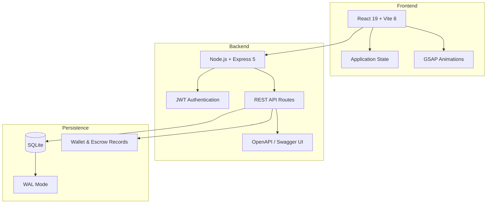

<div align="center">


# 🟠 WORKVERSE

### Where Talent Meets Opportunity.

**A Unified Freelance Marketplace & Project Management Workspace**

Discover talent. Find meaningful work. Collaborate with clients and teams. Manage projects, milestones, deliverables, and payment workflows — all from one workspace.

<p>
  <a href="#-overview">Overview</a> ·
  <a href="#-features">Features</a> ·
  <a href="#-architecture">Architecture</a> ·
  <a href="#-tech-stack">Tech Stack</a> ·
  <a href="#-getting-started">Getting Started</a> ·
  <a href="#-api-reference">API Reference</a>
</p>


<br />

| 🔎 DISCOVER | 🤝 COLLABORATE | 🚀 DELIVER |
|:---:|:---:|:---:|
| Find skilled professionals and project opportunities. | Coordinate proposals, teams, and conversations. | Track milestones, deliverables, and payment workflows. |

</div>

---

## 📑 Table of Contents

- [Overview](#-overview)
- [Key Features](#-features)
- [Platform Modules](#-platform-modules)
- [User Roles](#-user-roles)
- [Architecture](#-architecture)
- [Tech Stack](#-tech-stack)
- [Getting Started](#-getting-started)
- [API Reference](#-api-reference)
- [Testing and Build](#-testing-and-build)
- [Project Structure](#-project-structure)
- [Development Highlights](#-development-highlights)
- [Roadmap](#-roadmap)
- [Contributing](#-contributing)

---

## 🌐 Overview

**Workverse** is a full-stack freelance marketplace and project management platform designed to connect clients with freelancers and make their collaboration easier to manage.

The platform brings the major stages of freelance work into one connected experience:

**Discover talent → Find opportunities → Submit proposals → Manage projects → Deliver work → Track payments**

Instead of switching between separate tools, clients and freelancers can use Workverse to coordinate project activity, communication, files, milestones, and financial workflows.

### What Workverse aims to solve

- Fragmented communication between clients and freelancers.
- Difficulty tracking project progress and milestones.
- Disconnected proposal, contract, and deliverable workflows.
- Limited visibility into project-related payments and balances.

---

## ✨ Features

<table>
  <tr>
    <td width="50%">
      <h3>🎨 Responsive User Interface</h3>
      <p>A modern interface built around a Warm Ivory, Architectural Orange, and Charcoal design system.</p>
    </td>
    <td width="50%">
      <h3>🔎 Talent Discovery</h3>
      <p>Explore freelancer profiles, skills, portfolios, and professional experience.</p>
    </td>
  </tr>
  <tr>
    <td>
      <h3>💻 Project Discovery</h3>
      <p>Browse available opportunities, review project scopes, and submit proposals.</p>
    </td>
    <td>
      <h3>📊 Project Management</h3>
      <p>Organize projects, milestones, Kanban tasks, and progress from a unified hub.</p>
    </td>
  </tr>
  <tr>
    <td>
      <h3>💬 Workspace Messaging</h3>
      <p>Keep project-related conversations and collaboration in one place.</p>
    </td>
    <td>
      <h3>📁 Deliverables</h3>
      <p>Manage project files and deliverable records through the workspace.</p>
    </td>
  </tr>
  <tr>
    <td>
      <h3>💰 Escrow & Wallet Workflows</h3>
      <p>View balances, track payment records, and manage milestone payment actions.</p>
    </td>
    <td>
      <h3>📚 Knowledge Base</h3>
      <p>Browse searchable articles, guides, resources, and playbooks.</p>
    </td>
  </tr>
  <tr>
    <td>
      <h3>⚡ Command Palette</h3>
      <p>Navigate supported platform areas using <code>Ctrl + K</code> or <code>Cmd + K</code>.</p>
    </td>
    <td>
      <h3>🎬 Interface Motion</h3>
      <p>Use smooth interface transitions and animations powered by GSAP.</p>
    </td>
  </tr>
</table>

---

## 🧩 Platform Modules

### 1. Find Talent
A dedicated discovery experience for clients.

- Browse freelancer profiles and portfolios.
- Search and filter professionals.
- Review skills, experience, and project history.
- Open conversations with potential collaborators.

### 2. Find Work
A project discovery experience for freelancers.

- Browse available freelance opportunities.
- Search and filter projects.
- Review project descriptions and requirements.
- Inspect milestone-based budget breakdowns.
- Submit project proposals.

### 3. Projects Hub
A centralized workspace for managing project activity.

| Area | Purpose |
|---|---|
| Projects Directory | Create projects and track their status. |
| Proposals Manager | Review, evaluate, and respond to proposals. |
| Contracts | View awarded project contracts. |
| Kanban & Milestones | Organize tasks and monitor progress. |
| Messages | Coordinate project conversations. |
| Deliverables | Manage project file records. |
| Team Roster | View and coordinate project collaborators. |
| Escrow & Wallet | Track balances and payment records. |
| Workspace Settings | Manage available workspace preferences. |

### 4. Pricing & Resources

- Pricing plans with supported currency options.
- Monthly and annual billing selection.
- FAQ accordion.
- Searchable knowledge base.
- Guides, articles, and playbooks.

### 5. Global Command Palette

Use keyboard shortcuts to quickly access supported platform navigation.

| Platform | Shortcut |
|---|---|
| Windows / Linux | `Ctrl + K` |
| macOS | `Cmd + K` |

---

## 🔐 User Roles

Workverse is designed around two primary user roles.

| Capability | Client | Freelancer |
|---|:---:|:---:|
| Create projects | ✅ | — |
| Discover projects | ✅ | ✅ |
| Submit proposals | — | ✅ |
| Review proposals | ✅ | — |
| Manage project tasks | ✅ | ✅ |
| Review deliverables | ✅ | — |
| Upload deliverables | — | ✅ |
| Collaborate with a team | ✅ | ✅ |
| View relevant payment workflows | ✅ | ✅ |
| Manage freelancer portfolio | — | ✅ |

*Available actions depend on the current backend authorization rules and application implementation.*

---

## 🏗️ Architecture

Workverse uses a decoupled full-stack architecture. The React frontend communicates with a Node.js and Express REST API. The backend is responsible for authentication, application workflows, and database access.



### Engineering Overview

| Layer | Technology |
|---|---|
| Frontend | React 19 |
| Build Tool | Vite 8 |
| Backend Runtime | Node.js |
| API Framework | Express 5 |
| Authentication | JWT |
| Database | SQLite |
| Database Journal Mode | Write-Ahead Logging (WAL) |
| API Documentation | OpenAPI 3.0 / Swagger UI |
| Animation | GSAP |
| Version Control | Git and GitHub |
| CI | GitHub Actions |

---

## 🛠️ Tech Stack

<div align="center">

| Category | Technologies |
|---|---|
| Frontend | React, JavaScript |
| Build Tool | Vite |
| Styling | CSS |
| Animation | GSAP |
| Backend | Node.js, Express |
| Database | SQLite |
| Authentication | JSON Web Tokens (JWT) |
| API Documentation | OpenAPI 3.0, Swagger UI |
| Package Manager | npm |
| Version Control | Git, GitHub |
| Automation | GitHub Actions |
| Containerization | Docker, Docker Compose |

</div>

### Design System

| Color | Name | Hex |
|---|---|---|
| <span style="color:#FFF9F5">■</span> | Warm Ivory | `#FFF9F5` |
| <span style="color:#F36B21">■</span> | Architectural Orange | `#F36B21` |
| <span style="color:#171717">■</span> | Charcoal | `#171717` |

---

## ⚙️ Getting Started

Follow these steps to run the project locally.

### Prerequisites

- Node.js (v18 or later)
- npm (v9 or later)
- Git

### 1. Clone the repository

```bash
git clone https://github.com/rasesh13/freelance-project-axlero.git
cd freelance-project-axlero
```

### 2. Install dependencies

```bash
npm --prefix backend install
npm --prefix frontend install
```

### 3. Configure environment variables

Check the backend configuration and provide the environment variables required by the current backend implementation. Do not commit secrets, tokens, or local environment files.

If the repository includes an example environment file, copy it and fill in the required local values.

### 4. Start the backend

Open a terminal at the project root:

```bash
cd backend
npm start
```

The backend is expected to run at:

```text
http://localhost:5000
```

### 5. Start the frontend

Open a second terminal at the project root:

```bash
cd frontend
npm run dev
```

Open the Vite URL printed in the terminal (commonly `http://localhost:5173`).

### 6. Check backend health

If the health endpoint is enabled:

```powershell
Invoke-RestMethod http://localhost:5000/api/health
```

### Useful local endpoints

| Service | Address |
|---|---|
| Frontend | `http://localhost:5173` |
| Backend | `http://localhost:5000` |
| API base | `http://localhost:5000/api` |
| Swagger UI | `http://localhost:5000/docs` |
| OpenAPI JSON | `http://localhost:5000/openapi.json` |
| Health check | `http://localhost:5000/api/health` |

*Use the actual ports and routes configured in your local environment if they differ.*

### Docker

If Docker Compose is configured in the repository:

```bash
docker compose up --build
```

---

## 📡 API Reference

The backend exposes REST endpoints for the platform's main workflows. The table below is a quick reference; the current OpenAPI specification and backend route definitions are the source of truth.

| Method | Endpoint | Purpose |
|---|---|---|
| `GET` | `/api/health` | Check server health |
| `GET` | `/api/stats` | Retrieve platform statistics |
| `POST` | `/api/auth/login` | Authenticate a user |
| `POST` | `/api/auth/register` | Register an account |
| `GET` | `/api/auth/me` | Retrieve the authenticated profile |
| `GET` | `/api/projects` | Retrieve projects |
| `POST` | `/api/projects` | Create a project |
| `GET` | `/api/kanban` | Retrieve Kanban tasks |
| `POST` | `/api/kanban` | Create a task |
| `PATCH` | `/api/kanban/:id/column` | Update a task column |
| `GET` | `/api/contracts` | Retrieve contracts |
| `GET` | `/api/proposals` | Retrieve proposals |
| `GET` | `/api/messages` | Retrieve conversations |
| `POST` | `/api/messages` | Send a message |
| `GET` | `/api/files` | Retrieve deliverable records |
| `POST` | `/api/files` | Register a deliverable |
| `GET` | `/api/wallet` | Retrieve wallet information |
| `POST` | `/api/wallet/withdraw` | Submit a withdrawal request |
| `GET` | `/api/payments` | Retrieve payment records |
| `PATCH` | `/api/payments/:id/release` | Release a milestone payment |
| `GET` | `/api/settings` | Retrieve workspace settings |
| `PUT` | `/api/settings` | Update workspace settings |

Interactive API documentation, when enabled, is available at `/docs`.

---

## 🧪 Testing and Build

Run commands from the repository root unless stated otherwise.

### Backend tests

```bash
npm test --prefix backend
```

If the backend package defines these scripts, they can also be run individually:

```bash
npm run test:api --prefix backend
npm run test:db --prefix backend
npm run test:health --prefix backend
```

### Frontend production build

```bash
cd frontend
npm install
npm run build
```

The production build is generated in:

```text
frontend/dist
```

### Continuous Integration

The repository uses GitHub Actions to automate configured verification checks on supported branch pushes and pull requests. Check the Actions tab for the latest workflow result.

---

## 📂 Project Structure

```text
freelance-project-axlero/
│
├── backend/
│   ├── dashboard.js
│   ├── db.js
│   ├── openapi.js
│   ├── server.js
│   ├── package.json
│   └── package-lock.json
│
├── frontend/
│   ├── public/
│   ├── src/
│   │   ├── api/
│   │   ├── components/
│   │   ├── pages/
│   │   │   └── ProjectsHubPage.jsx
│   │   ├── App.jsx
│   │   └── main.jsx
│   ├── package.json
│   ├── package-lock.json
│   └── vite.config.js
│
├── docs/
└── README.md
```

*The structure above highlights the main application areas; the repository may contain additional files and modules.*

---

## 🧭 Development Highlights

The project has evolved through iterative development, with work across the following areas:

- Core marketplace interface and responsive navigation.
- Find Talent and Find Work experiences.
- Projects Hub, project setup, and Kanban workflows.
- Express REST API and SQLite persistence.
- JWT-based authentication.
- Proposals, contracts, messaging, and workspace settings.
- Wallet, escrow, and payment-related workflows.
- API documentation and automated verification.
- GitHub Actions CI workflow.
- Docker configuration and PWA-related capabilities.

---

## 🗺️ Roadmap

Potential areas for future improvement:

- Real-time messaging and notifications.
- More advanced project analytics and reporting.
- Integration with a production payment gateway.
- Improved file sharing and collaboration.
- Automated project workflow management.
- Smarter freelancer discovery and recommendations.
- Expanded dashboard customization.

---

## 🤝 Contributing

Contributions, ideas, and feedback are welcome.

1. Fork the repository.
2. Create a feature branch:

   ```bash
   git checkout -b feature/your-feature
   ```

3. Make focused changes and run the relevant checks.
4. Commit your work:

   ```bash
   git commit -m "feat: describe your change"
   ```

5. Push your branch:

   ```bash
   git push origin feature/your-feature
   ```

6. Open a Pull Request with a clear description of the changes.

---

<div align="center">

## 🟠 WORKVERSE

### Where Talent Meets Opportunity.

**Discover. Collaborate. Deliver.**

A unified workspace built to connect businesses and freelancers and simplify project collaboration.

<br />

**Built with ❤️ by the Workverse Development Team**

<sub>© Workverse — All rights reserved.</sub>

</div>
