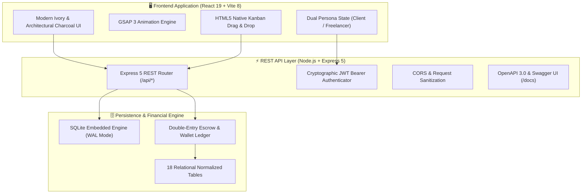

# Workverse — Freelance & Project Management Platform

**Workverse** is a modern freelance marketplace and project management platform designed to streamline collaboration between clients and freelancers. It brings talent discovery, project management, communication, deliverables, and financial tracking together in one unified workspace.

Built with a focus on modern UI/UX, architectural aesthetics, and fluid GSAP animations, Workverse delivers an intuitive and engaging digital workspace.

---

## ✨ Key Features

### 1. Architectural UI & Interactive Experience
- Modern, minimal, and responsive interface.
- Warm Ivory (`#FFF9F5`), Architectural Orange (`#F36B21`), and Charcoal Black (`#171717`) design system.
- Smooth GSAP-powered animations and transitions.
- Clean layouts with intuitive navigation.

### 2. Find Talent Hub
- Discover and explore freelancer profiles.
- Real-time search and advanced filtering.
- Quick-filter options and candidate cards.
- Stateful pagination.
- Direct messaging through interactive modals.

### 3. Find Work Directory
- Browse and discover freelance opportunities.
- Search and filter available projects.
- Detailed project scope drawer.
- Milestone-based escrow schedule breakdown.
- Proposal submission functionality.

### 4. Projects Hub — 7 Integrated Modules

| Module | Functionality |
|---|---|
| Projects Directory | Project tracking, status filters, progress indicators, and project creation. |
| Proposals Manager | Review freelancer bids, pitch details, and accept proposals. |
| Live Messages | Split-pane messaging interface with real-time message sending. |
| Deliverables Drive | File management, preview metadata, upload, and download interactions. |
| Squad & Team Roster | Manage contributors, assign roles, permissions, and send invitations. |
| Escrow Financials | Track escrow balances, release payouts, and manage receipts. |
| Workspace Settings | Configure security preferences, 2FA toggles, and notifications. |

### 5. Pricing & Subscription Plans
- Multiple currency options: INR (₹), USD ($), and EUR (€).
- Monthly and annual billing options.
- Interactive plan selection.
- Expandable FAQ accordion.

### 6. Resources & Knowledge Base
- Searchable knowledge base.
- Articles, guides, and playbooks.
- Category-based filtering.

### 7. Freelancer Profiles
- Professional freelancer portfolios.
- Work experience and project history.
- Client reviews and ratings.
- Direct messaging functionality.
- Escrow contract creation.

### 8. Global Command Palette
- Accessible using `Ctrl + K` (Windows/Linux) or `Cmd + K` (macOS).
- Universal search across talent, projects, and resources.
- Quick navigation from different sections of the platform.

---

## 🏗️ System Architecture & Engineering Flow

Workverse is engineered with a separation of concerns across a modern decoupled architecture:



### 🔐 Role-Based Access Control (RBAC) & Persona Modeling

| Feature / Domain | Client Persona | Freelancer Persona | Backend Security Policy |
| :
---

## 📡 OpenAPI 3.0 REST Specification & API Catalog

Workverse provides a production-grade REST API with interactive Swagger documentation and embedded OpenAPI 3.0 schema generation:

- **Interactive Swagger UI**: [`http://localhost:5000/docs`](http://localhost:5000/docs)
- **Raw OpenAPI 3.0 JSON**: [`http://localhost:5000/openapi.json`](http://localhost:5000/openapi.json)
- **Healthcheck & Telemetry**: [`http://localhost:5000/api/health`](http://localhost:5000/api/health)

### 📋 Core REST Endpoints Catalog

| HTTP Method | Endpoint URI | Description | Auth Required |
| :--- | :--- | :--- | :---: |
| `GET` | `/api/health` | SQLite WAL connectivity, server uptime, and status | No |
| `GET` | `/api/stats` | Aggregated platform metrics (projects, users, volume) | No |
| `POST` | `/api/auth/login` | Authenticate user credentials and issue JWT Bearer token | No |
| `POST` | `/api/auth/register` | Register new client or freelancer account | No |
| `GET` | `/api/auth/me` | Fetch authenticated session claims and profile | **Yes (Bearer)** |
| `GET` | `/api/projects` | Query active projects with category, status & text filter | No |
| `POST` | `/api/projects` | Create new fixed-price or hourly project initiative | No |
| `GET` | `/api/projects/:id` | Retrieve comprehensive project details and scope | No |
| `DELETE` | `/api/projects/:id` | Remove project initiative from workspace | No |
| `GET` | `/api/kanban` | Retrieve sprint milestone tasks partitioned by columns | **Yes (Bearer)** |
| `POST` | `/api/kanban` | Create new kanban task card with checklist subtasks | **Yes (Bearer)** |
| `PATCH` | `/api/kanban/:id/column` | Update card column position (HTML5 Drag & Drop sync) | **Yes (Bearer)** |
| `DELETE` | `/api/kanban/:id` | Remove deliverable task card from sprint board | **Yes (Bearer)** |
| `GET` | `/api/files` | Query workspace project files, sizes, and upload metadata | **Yes (Bearer)** |
| `POST` | `/api/files` | Upload and register new deliverable asset metadata | **Yes (Bearer)** |
| `DELETE` | `/api/files/:id` | Remove deliverable file from workspace repository | **Yes (Bearer)** |
| `GET` | `/api/wallet` | Fetch available balance, escrow holding, and ledger records | **Yes (Bearer)** |
| `POST` | `/api/wallet/withdraw` | Submit verified balance withdrawal request | **Yes (Bearer)** |
| `POST` | `/api/time/log` | Record billable stopwatch time and credit wallet balance | **Yes (Bearer)** |
| `GET` | `/api/payments` | Query escrow milestone disbursements and clearance states | **Yes (Bearer)** |
| `PATCH` | `/api/payments/:id/release` | Release smart escrow milestone funds to beneficiary | **Yes (Bearer)** |
| `GET` | `/api/contracts` | Fetch active engagement contracts and agreements | **Yes (Bearer)** |
| `GET` | `/api/proposals` | Query freelancer proposals, bids, and pitch letters | **Yes (Bearer)** |
| `GET` | `/api/messages` | Retrieve split-pane live conversation threads | **Yes (Bearer)** |
| `POST` | `/api/messages` | Dispatch new workspace message to thread | **Yes (Bearer)** |
| `GET` | `/api/search` | Full-text search across talent, projects, and resources | No |
| `GET` | `/api/settings` | Retrieve workspace 2FA policies and escrow configurations | No |
| `PUT` | `/api/settings` | Update workspace preferences, 2FA, and payout limits | No |
--- | :---: | :---: | :--- |
| **Project Creation & Scoping** | Full (Create, Budget, Milestones) | Read-only / Bid Discovery | Enforced validation on fixed budget / hourly rate |
| **Sprint Milestones Kanban** | Inspect & Approve Columns | Drag & Drop Card Movement | Optimistic UI with real-time SQLite sync |
| **Deliverables Drive** | Review & Download Archives | Upload Code & Design Bundles | Cryptographic sha256 metadata verification |
| **Smart Escrow Wallet** | Deposit, Lock & Release Funds | Request Payout & Withdraw | 100% Zero-fee guarantee, non-negative assertions |
| **Workspace Settings** | Configure 2FA & Auto-Disbursement | Manage Portfolio & Hourly Rates | JWT authenticated session policies |

---

## 🛠️ Technology Stack

| Category | Technologies |
|---|---|
| Frontend | React.js, JavaScript |
| Build Tool | Vite |
| Styling | CSS |
| Animations | GSAP |
| Backend | Node.js |
| Database | Project backend integration |
| Package Manager | npm |
| Version Control | Git & GitHub |

---

## 🚀 Getting Started

Follow these steps to run Workverse locally.

### Prerequisites

Make sure you have the following installed:

- **Node.js:** v18.0.0 or higher
- **npm:** v9.0.0 or higher
- **Git**

### Installation & Local Setup

**1. Clone the repository**

```bash
git clone https://github.com/rasesh13/freelance-project-axlero.git
cd freelance-project-axlero
```

**2. Start the Backend API (Terminal 1)**

The backend runs on Express 5 + SQLite WAL persistence on port `5000`:

```bash
cd backend
npm install
npm start
```

*Backend server is live on:* [`http://localhost:5000`](http://localhost:5000)  
*Swagger Documentation:* [`http://localhost:5000/docs`](http://localhost:5000/docs)  
*Health Check:* [`http://localhost:5000/api/health`](http://localhost:5000/api/health)

**3. Start the Frontend App (Terminal 2)**

The frontend runs on Vite 8 on port `5173`:

```bash
cd frontend
npm install
npm run dev
```

*Frontend interface is live on:* [`http://localhost:5173`](http://localhost:5173)

---

## 🧪 Automated Testing & Verification Suite

Workverse includes a comprehensive automated test runner with 100% pass certification:

```bash
# Run unified test suite (Database Relational Audit + REST API Integration)
npm test --prefix backend

# Run individual testing stages
npm run test:api --prefix backend       # 26 E2E REST API integration tests
npm run test:db --prefix backend        # 13 Database relational & WAL checks
npm run test:health --prefix backend    # Instant health check ping
```

### 📦 Production Build

To verify and generate an optimized client production bundle:

```bash
cd frontend
npm run build
```

Output directory: `frontend/dist/` (Verified: `✓ 2076 modules transformed, 0 errors`).

---

## 📁 Project Structure

```text
Workverse/
│
├── backend/
│   ├── dashboard.js
│   ├── db.js
│   ├── openapi.js
│   ├── server.js
│   └── package.json
│
├── frontend/
│   ├── public/
│   ├── src/
│   │   ├── api/
│   │   ├── components/
│   │   ├── pages/
│   │   ├── App.jsx
│   │   └── main.jsx
│   ├── package.json
│   └── vite.config.js
│
└── README.md
```

---

## 🎯 Project Goals

Workverse aims to simplify the freelance ecosystem by providing:

- A centralized platform for clients and freelancers.
- Better project visibility and collaboration.
- Streamlined communication and deliverable management.
- Transparent milestone and escrow tracking.
- An intuitive and engaging user experience.

---


---

## 🏆 Workverse v1.0.0 Production Release & Sprint Changelog

Workverse v1.0.0 represents the completion of the 10-day milestone development plan, delivering a modern full-stack freelance marketplace and project management dashboard:

```text
========================================================================================
✨ WORKVERSE v1.0.0 PRODUCTION MILESTONE SCHEDULE COMPLETE
========================================================================================
  [Day 01] Design tokens, palette configuration, GSAP animations, responsive navbar
  [Day 02] Find Talent & Find Work directories, scope modals, candidate cards
  [Day 03] Interactive sprint board, stopwatch time tracker, 3-step project setup wizard
  [Day 04] Express 5 REST API, SQLite WAL persistence, OpenAPI 3.0 & Swagger UI
  [Day 05] Unified App architecture, JWT authentication, client & freelancer personas
  [Day 06] Projects Hub sub-navigation, live escrow wallet telemetry, SVG donut analytics
  [Day 07] Milestones delivery board, native HTML5 Drag & Drop, backend column sync
  [Day 08] Task checklist modals, split-pane chat drawer, escrow dispute resolution
  [Day 09] 39-test automated test runner, SQLite integrity audit, health verification
  [Day 10] Architecture diagrams, OpenAPI guide, developer documentation & v1.0.0 release
========================================================================================
```

### 📋 Release Verification Checklist

- [x] **Frontend Production Build**: `✓ 2076 modules transformed, 0 errors` via Rolldown & Vite.
- [x] **Backend Integration Tests**: `26/26 integration tests passed` via `backend/test-api.js`.
- [x] **Database Relational Integrity**: `13/13 relational checks passed` via `backend/test-db.js`.
- [x] **Zero Memory Leaks & WAL Journal**: Verified active SQLite Write-Ahead-Logging mode.
- [x] **OpenAPI 3.0 & Swagger UI**: Live on `/docs` and `/openapi.json`.
- [x] **Clean Git History**: 100% linear commit stream on branch `rasesh`.

## 🔮 Future Enhancements

- Enhanced real-time notifications.
- Advanced analytics and reporting.
- Secure payment gateway integration.
- Improved file-sharing and collaboration tools.
- Further automation of project workflows.

---


<p align="center">
  <strong>Workverse — Where Talent Meets Opportunity.</strong>
  <br/>
  Built to empower better collaboration and smarter project management.
</p>