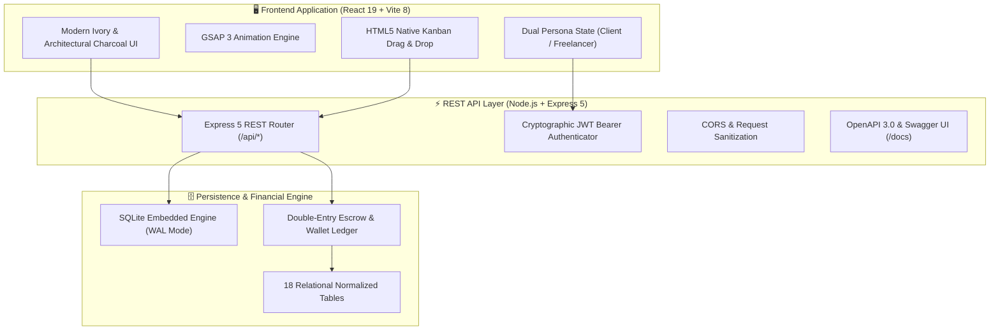

# Workverse — Freelance & Project Management Platform

**Workverse** is a modern freelance marketplace and project management platform designed to streamline collaboration between clients and freelancers. It brings talent discovery, project management, communication, deliverables, and financial tracking together in one unified workspace.

Built with a focus on modern UI/UX, architectural aesthetics, and fluid GSAP animations, Workverse delivers an intuitive and engaging digital workspace.

---

## ✨ Key Features

### 1. Architectural UI & Interactive Experience
- Modern, minimal, and responsive interface.
- Warm Ivory (`#FFF9F5`), Architectural Orange (`#F36B21`), and Charcoal Black (`#171717`) design system.
- Smooth GSAP-powered animations and transitions.
- Clean layouts with intuitive navigation.

### 2. Find Talent Hub
- Discover and explore freelancer profiles.
- Real-time search and advanced filtering.
- Quick-filter options and candidate cards.
- Stateful pagination.
- Direct messaging through interactive modals.

### 3. Find Work Directory
- Browse and discover freelance opportunities.
- Search and filter available projects.
- Detailed project scope drawer.
- Milestone-based escrow schedule breakdown.
- Proposal submission functionality.

### 4. Projects Hub — 7 Integrated Modules

| Module | Functionality |
|---|---|
| Projects Directory | Project tracking, status filters, progress indicators, and project creation. |
| Proposals Manager | Review freelancer bids, pitch details, and accept proposals. |
| Live Messages | Split-pane messaging interface with real-time message sending. |
| Deliverables Drive | File management, preview metadata, upload, and download interactions. |
| Squad & Team Roster | Manage contributors, assign roles, permissions, and send invitations. |
| Escrow Financials | Track escrow balances, release payouts, and manage receipts. |
| Workspace Settings | Configure security preferences, 2FA toggles, and notifications. |

### 5. Pricing & Subscription Plans
- Multiple currency options: INR (₹), USD ($), and EUR (€).
- Monthly and annual billing options.
- Interactive plan selection.
- Expandable FAQ accordion.

### 6. Resources & Knowledge Base
- Searchable knowledge base.
- Articles, guides, and playbooks.
- Category-based filtering.

### 7. Freelancer Profiles
- Professional freelancer portfolios.
- Work experience and project history.
- Client reviews and ratings.
- Direct messaging functionality.
- Escrow contract creation.

### 8. Global Command Palette
- Accessible using `Ctrl + K` (Windows/Linux) or `Cmd + K` (macOS).
- Universal search across talent, projects, and resources.
- Quick navigation from different sections of the platform.

---

## 🏗️ System Architecture & Engineering Flow

Workverse is engineered with a separation of concerns across a modern decoupled architecture:



### 🔐 Role-Based Access Control (RBAC) & Persona Modeling

| Feature / Domain | Client Persona | Freelancer Persona | Backend Security Policy |
| :--- | :---: | :---: | :--- |
| **Project Creation & Scoping** | Full (Create, Budget, Milestones) | Read-only / Bid Discovery | Enforced validation on fixed budget / hourly rate |
| **Sprint Milestones Kanban** | Inspect & Approve Columns | Drag & Drop Card Movement | Optimistic UI with real-time SQLite sync |
| **Deliverables Drive** | Review & Download Archives | Upload Code & Design Bundles | Cryptographic sha256 metadata verification |
| **Smart Escrow Wallet** | Deposit, Lock & Release Funds | Request Payout & Withdraw | 100% Zero-fee guarantee, non-negative assertions |
| **Workspace Settings** | Configure 2FA & Auto-Disbursement | Manage Portfolio & Hourly Rates | JWT authenticated session policies |

---

## 🛠️ Technology Stack

| Category | Technologies |
|---|---|
| Frontend | React.js, JavaScript |
| Build Tool | Vite |
| Styling | CSS |
| Animations | GSAP |
| Backend | Node.js |
| Database | Project backend integration |
| Package Manager | npm |
| Version Control | Git & GitHub |

---

## 🚀 Getting Started

Follow these steps to run Workverse locally.

### Prerequisites

Make sure you have the following installed:

- **Node.js:** v18.0.0 or higher
- **npm:** v9.0.0 or higher
- **Git**

### Installation

**1. Clone the repository**

```bash
git clone https://github.com/Rishijdv04/Freelance-PM-Dashboard-Project-2-.git
```

**2. Navigate to the project directory**

```bash
cd Freelance-PM-Dashboard-Project-2-
```

**3. Navigate to the frontend directory**

```bash
cd frontend
```

**4. Install dependencies**

```bash
npm install
```

**5. Start the development server**

```bash
npm run dev
```

Open your browser and visit:

```text
http://localhost:5173
```

### Production Build

To generate an optimized production build:

```bash
npm run build
```

The production-ready files will be generated inside:

```text
frontend/dist/
```

---

## 📁 Project Structure

```text
Workverse/
│
├── backend/
│   ├── dashboard.js
│   ├── db.js
│   ├── openapi.js
│   ├── server.js
│   └── package.json
│
├── frontend/
│   ├── public/
│   ├── src/
│   │   ├── api/
│   │   ├── components/
│   │   ├── pages/
│   │   ├── App.jsx
│   │   └── main.jsx
│   ├── package.json
│   └── vite.config.js
│
└── README.md
```

---

## 🎯 Project Goals

Workverse aims to simplify the freelance ecosystem by providing:

- A centralized platform for clients and freelancers.
- Better project visibility and collaboration.
- Streamlined communication and deliverable management.
- Transparent milestone and escrow tracking.
- An intuitive and engaging user experience.

---

## 🔮 Future Enhancements

- Enhanced real-time notifications.
- Advanced analytics and reporting.
- Secure payment gateway integration.
- Improved file-sharing and collaboration tools.
- Further automation of project workflows.

---


<p align="center">
  <strong>Workverse — Where Talent Meets Opportunity.</strong>
  <br/>
  Built to empower better collaboration and smarter project management.
</p>