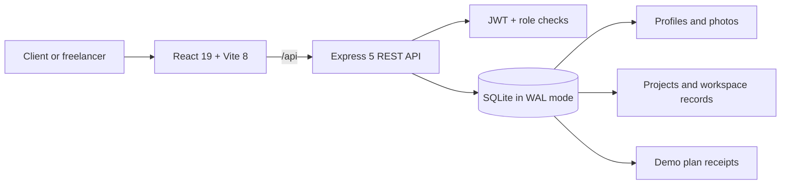

<div align="center">


# Workverse

### Find the right people. Build the right work.

**A freelance marketplace and project workspace for clients and independent builders.**

[Explore features](#what-you-can-do) · [Run locally](#run-it-locally) · [API docs](#api-and-project-structure) · [Project status](#project-status)

<br />

[](https://github.com/rasesh13/freelance-project-axlero/actions/workflows/ci.yml)


</div>


> **Local-first demo:** Accounts, profiles, projects, proposals, messages, and workspace records are stored in SQLite. Subscription checkout is simulated; no real money moves.

## What you can do

| Discover | Collaborate | Manage |
| :--- | :--- | :--- |
| Browse registered freelancer profiles and current project postings. | Submit proposals, exchange messages, and share deliverables. | Track contracts, Kanban tasks, milestones, and workspace activity. |
| Search and filter talent, work, and resources. | Invite registered collaborators to a project team. | Review demo payment records and plan receipts. |

### For freelancers

- Create a public profile with your title, skills, availability, and an illustrated avatar.
- Upload your own JPEG, PNG, or WebP profile photo (up to 2 MB), or keep the default avatar.
- Find posted work, save projects, submit proposals, and manage awarded contracts.
- Track time, tasks, files, messages, and recorded milestone status in the workspace.

### For clients

- Discover registered specialists and inspect their public profiles.
- Post projects, review proposals, coordinate teams, and follow delivery progress.
- Organize work with a Kanban board, deliverables, and project conversations.

### Across the platform

- JWT-based accounts with separate client and freelancer roles.
- Searchable resources, notifications, bookmarks, and keyboard navigation (`Ctrl/Cmd + K`).
- Pricing plans with **demo-only checkout** and receipts saved to the signed-in account.
- Responsive React interface with architectural imagery, motion, and a PWA manifest.

## Run it locally

**Requirements:** Node.js 22 or newer, npm, and Git.

```bash
git clone https://github.com/rasesh13/freelance-project-axlero.git
cd freelance-project-axlero
npm --prefix backend ci
npm --prefix frontend ci
npm run dev
```

Open **[http://localhost:5173](http://localhost:5173)**. The Express API runs at **[http://localhost:5000](http://localhost:5000/api/health)**. Vite proxies `/api` requests to the backend, so both services must be running.

New local databases start without demo accounts or fake project listings. Create a client or freelancer account in the app to populate the marketplace.

<details>
<summary><strong>Environment configuration</strong></summary>

For a stable local sign-in across backend restarts, copy `backend/.env.example` to `backend/.env` and replace the sample `JWT_SECRET` with your own long random value. Production startup requires `JWT_SECRET`.

| Variable | Purpose | Default |
| :--- | :--- | :--- |
| `PORT` | Express API port | `5000` |
| `JWT_SECRET` | Signs login tokens | Random per process in development; required in production |
| `CORS_ORIGIN` | Comma-separated allowed frontend origins | Localhost Vite origins |
| `WORKVERSE_DB_PATH` | Optional SQLite file location | `backend/database.sqlite` |
| `WORKVERSE_SEED_DEMO_DATA` | Opt in to fixture accounts for development/tests | Disabled |

</details>

The frontend uses Vite's `/api` proxy by default. If you host the frontend and API separately, set `VITE_API_BASE_URL` to the full API prefix (for example, `https://api.example.com/api`) in `frontend/.env`, and add the frontend origin to the backend's `CORS_ORIGIN`.

### Useful commands

| Command | Result |
| :--- | :--- |
| `npm run dev` | Start frontend and backend together |
| `npm test` | Run database, API, ownership, backup, and frontend API client checks |
| `npm run build` | Build the React app for production |
| `npm run backup` | Create a SQLite backup |

## How it fits together



The UI reads marketplace and workspace data through the API. SQLite holds user-created records and locally uploaded profile photos; the backend checks ownership for protected actions. See [the API documentation](docs/API_DOCUMENTATION.md) for endpoint details.

## Project status

Workverse is an **interactive local application**, with these boundaries:

| Available now | Demo or not connected |
| :--- | :--- |
| Registered accounts, profile editing and photo upload | Real card charging and recurring subscriptions |
| Project postings, proposals, messages, files, and workspace records | Real escrow custody and freelancer payouts |
| Plan selection and stored **simulated** receipts | Outbound email delivery for newsletter/password reset |

Plan selection records a simulated receipt and updates the account's demo tier. It does **not** transfer funds, unlock unimplemented enterprise services, or fund a project contract.

## API and project structure

| Location | What lives there |
| :--- | :--- |
| [`frontend/src`](frontend/src) | React pages, components, API client, and avatar UI |
| [`frontend/public`](frontend/public) | Static images, icons, and PWA assets |
| [`backend/server.js`](backend/server.js) | Express routes and authorization |
| [`backend/db.js`](backend/db.js) | SQLite schema, migrations, and optional fixtures |
| [`backend/avatar.js`](backend/avatar.js) | Generated avatar art and photo validation |
| [`docs/API_DOCUMENTATION.md`](docs/API_DOCUMENTATION.md) | Detailed API reference |

When running locally, visit **[API documentation](http://localhost:5000/docs)** or **[OpenAPI JSON](http://localhost:5000/openapi.json)**. These links require the backend to be running.

## Contributing

1. Create a branch for one focused change.
2. Run `npm test` and `npm run build` before opening a pull request.
3. Describe what changed, how you verified it, and any remaining limitations.

<div align="center">

---

**Workverse** · Discover talent. Coordinate work. Deliver together.

[Back to top](#workverse) · [Contributors](https://github.com/rasesh13/freelance-project-axlero/graphs/contributors)

</div>
