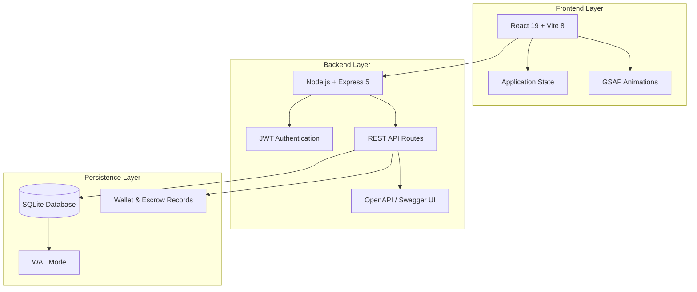

<div align="center">


# 🟠 WORKVERSE

### Where Talent Meets Opportunity.

**A Unified Freelance Marketplace & Project Management Workspace**

Discover talent. Find meaningful work. Collaborate with clients and teams. Manage projects, milestones, deliverables, and payment workflows — all from one workspace.

<p>
  <a href="#overview">Overview</a> ·
  <a href="#features">Features</a> ·
  <a href="#architecture">Architecture</a> ·
  <a href="#tech-stack">Tech Stack</a> ·
  <a href="#getting-started">Getting Started</a> ·
  <a href="#api-reference">API Reference</a>
</p>


<br />

| 🔎 DISCOVER | 🤝 COLLABORATE | 🚀 DELIVER |
|:---:|:---:|:---:|
| Find skilled professionals and project opportunities. | Coordinate proposals, teams, and conversations. | Track milestones, deliverables, and payment workflows. |

</div>

---

## 📑 Table of Contents

- [Overview](#overview)
- [Features](#features)
- [Platform Modules](#platform-modules)
- [User Roles](#user-roles)
- [Architecture](#architecture)
- [Tech Stack](#tech-stack)
- [Getting Started](#getting-started)
- [API Reference](#api-reference)
- [Testing and Build](#testing-and-build)
- [Project Structure](#project-structure)
- [Development Highlights](#development-highlights)
- [Roadmap](#roadmap)
- [Contributing](#contributing)

---

## 🌐 Overview

**Workverse** is a full-stack freelance marketplace and project management platform designed to connect clients with freelancers and simplify the way they work together.

It brings essential freelance workflows into a unified digital workspace, allowing users to discover opportunities, manage projects, coordinate teams, exchange deliverables, and track payment-related activities.

### The Workverse Workflow

**Discover Talent → Explore Opportunities → Submit Proposals → Manage Projects → Deliver Work → Track Payments**

### The Problem We Aim to Solve

Freelance collaboration often involves multiple disconnected tools and workflows.

Workverse aims to address these challenges:

- Fragmented communication between clients and freelancers.
- Difficulty managing project progress and milestones.
- Disconnected proposal, contract, and deliverable workflows.
- Limited visibility into project-related payment activities.
- Inefficient coordination between project participants.

### Our Vision

To create a centralized workspace where clients and freelancers can manage their professional collaboration more efficiently, transparently, and productively.

---

## ✨ Features

<table>
  <tr>
    <td width="50%">
      <h3>🎨 Responsive User Interface</h3>
      <p>A modern, responsive interface built around a Warm Ivory, Architectural Orange, and Charcoal design system.</p>
    </td>
    <td width="50%">
      <h3>🔎 Talent Discovery</h3>
      <p>Explore freelancer profiles, professional skills, portfolios, and experience.</p>
    </td>
  </tr>
  <tr>
    <td>
      <h3>💻 Project Discovery</h3>
      <p>Browse freelance opportunities, review project requirements, and submit proposals.</p>
    </td>
    <td>
      <h3>📊 Project Management</h3>
      <p>Organize projects, milestones, Kanban tasks, and progress through a centralized workspace.</p>
    </td>
  </tr>
  <tr>
    <td>
      <h3>💬 Workspace Messaging</h3>
      <p>Keep project-related conversations and collaboration activities organized.</p>
    </td>
    <td>
      <h3>📁 Deliverables Management</h3>
      <p>Manage project files, deliverable records, and submission workflows.</p>
    </td>
  </tr>
  <tr>
    <td>
      <h3>💰 Escrow & Wallet Workflows</h3>
      <p>View balances, track financial records, and manage milestone payment actions.</p>
    </td>
    <td>
      <h3>📚 Knowledge Base</h3>
      <p>Explore searchable articles, guides, resources, and professional playbooks.</p>
    </td>
  </tr>
  <tr>
    <td>
      <h3>⚡ Global Command Palette</h3>
      <p>Navigate supported platform sections using Ctrl + K or Cmd + K.</p>
    </td>
    <td>
      <h3>🎬 Interface Animations</h3>
      <p>Enhance the user experience with smooth transitions and GSAP-powered animations.</p>
    </td>
  </tr>
</table>

---

## 🧩 Platform Modules

### 1. Find Talent

A dedicated discovery experience that helps clients explore professionals.

- Browse freelancer profiles and portfolios.
- Search and filter professionals.
- Review skills, experience, and project history.
- Connect with potential collaborators.

### 2. Find Work

A project discovery experience designed for freelancers.

- Browse available freelance opportunities.
- Search and filter projects.
- Review project descriptions and requirements.
- Explore milestone-based budget breakdowns.
- Submit project proposals.

### 3. Projects Hub

A centralized workspace for managing project-related activities.

| Module | Description |
|---|---|
| Projects Directory | Create projects and monitor their status. |
| Proposals Manager | Review, evaluate, and respond to proposals. |
| Contracts | Access awarded project contracts. |
| Kanban & Milestones | Organize tasks and monitor project progress. |
| Messages | Coordinate project-related conversations. |
| Deliverables | Manage project file and delivery records. |
| Team Roster | View and coordinate project collaborators. |
| Escrow & Wallet | Track balances and payment-related records. |
| Workspace Settings | Manage available workspace preferences. |

### 4. Pricing & Resources

- Pricing plans with supported currency options.
- Monthly and annual billing selection.
- Frequently Asked Questions section.
- Searchable knowledge base.
- Guides, articles, and professional playbooks.

### 5. Global Command Palette

Navigate supported platform sections using keyboard shortcuts.

| Operating System | Shortcut |
|---|---|
| Windows / Linux | `Ctrl + K` |
| macOS | `Cmd + K` |

---

## 🔐 User Roles

Workverse is designed around two primary user roles: Clients and Freelancers.

| Capability | Client | Freelancer |
|---|:---:|:---:|
| Create projects | ✅ | — |
| Discover projects | ✅ | ✅ |
| Submit proposals | — | ✅ |
| Review proposals | ✅ | — |
| Manage project tasks | ✅ | ✅ |
| Review deliverables | ✅ | — |
| Upload deliverables | — | ✅ |
| Collaborate with a team | ✅ | ✅ |
| View relevant payment workflows | ✅ | ✅ |
| Manage freelancer portfolio | — | ✅ |

*Available operations are subject to the application's implemented authorization rules and role permissions.*

---

## 🏗️ Architecture

Workverse follows a decoupled full-stack architecture.

The React frontend communicates with a Node.js and Express REST API. The backend handles authentication, application workflows, business logic, and database operations.

### System Architecture



### Architecture Overview

| Layer | Technology | Responsibility |
|---|---|---|
| Frontend | React 19 | User interface and application experience |
| Build Tool | Vite 8 | Development server and production builds |
| Backend Runtime | Node.js | Server-side execution |
| API Framework | Express 5 | REST API and request handling |
| Authentication | JWT | Token-based authentication |
| Database | SQLite | Persistent application data |
| Database Mode | WAL | Database journaling and concurrency |
| API Documentation | OpenAPI 3.0 / Swagger UI | API specifications and interactive documentation |
| Animation | GSAP | Interface motion and transitions |
| Version Control | Git / GitHub | Source control and collaboration |
| CI | GitHub Actions | Automated verification |

---

## 🛠️ Tech Stack

### Frontend

- React 19
- JavaScript
- Vite 8
- CSS
- GSAP

### Backend

- Node.js
- Express 5
- REST API
- JSON Web Tokens (JWT)

### Database & Persistence

- SQLite
- Write-Ahead Logging (WAL)

### Development & Deployment

- npm
- Git
- GitHub
- GitHub Actions
- Docker
- Docker Compose

### API Documentation

- OpenAPI 3.0
- Swagger UI

### Design System

Workverse uses a distinctive visual identity based on warm neutral surfaces, architectural orange accents, and charcoal typography.

| Color | Design Role | Hex |
|---|---|---|
| Warm Ivory | Primary Background | `#FFF9F5` |
| Architectural Orange | Primary Accent | `#F36B21` |
| Charcoal | Primary Text | `#171717` |

---

## ⚙️ Getting Started

Follow the instructions below to set up Workverse locally.

### Prerequisites

Install the following tools before starting:

- Node.js 22.x (recommended to match the CI workflow)
- npm
- Git

### 1. Clone the Repository

```bash
git clone https://github.com/rasesh13/freelance-project-axlero.git

cd freelance-project-axlero
```

### 2. Install Dependencies

Install backend dependencies:

```bash
cd backend
npm install
```

Install frontend dependencies in a separate terminal:

```bash
cd frontend
npm install
```

### 3. Configure Environment Variables

Check the backend configuration and provide the environment variables required by the application.

If the repository contains an example environment file, use it as a template.

Never commit:

- Database credentials.
- JWT secrets.
- API keys.
- Private configuration files.
- Production environment variables.

### 4. Start the Backend

From the repository root:

```bash
cd backend
npm start
```

The backend is expected to run on:

```text
http://localhost:5000
```

### 5. Start the Frontend

Open another terminal:

```bash
cd frontend
npm run dev
```

Open the local URL displayed by Vite, commonly:

```text
http://localhost:5173
```

### 6. Verify Backend Health

If the health endpoint is enabled:

```powershell
Invoke-RestMethod http://localhost:5000/api/health
```

### Local Development Endpoints

| Service | Local Address |
|---|---|
| Frontend | `http://localhost:5173` |
| Backend | `http://localhost:5000` |
| API Base | `http://localhost:5000/api` |
| Swagger UI | `http://localhost:5000/docs` |
| OpenAPI JSON | `http://localhost:5000/openapi.json` |
| Health Check | `http://localhost:5000/api/health` |

*Actual ports and routes depend on the application's current configuration.*

### Docker Setup

If Docker Compose is configured:

```bash
docker compose up --build
```

---

## 📡 API Reference

Workverse exposes REST API endpoints for its primary application workflows.

The following table provides a quick overview. The backend route definitions and OpenAPI specification should be treated as the source of truth for request parameters, response schemas, authentication requirements, and supported operations.

| Method | Endpoint | Description |
|---|---|---|
| `GET` | `/api/health` | Check server health |
| `GET` | `/api/stats` | Retrieve platform statistics |
| `POST` | `/api/auth/login` | Authenticate a user |
| `POST` | `/api/auth/register` | Register a new account |
| `GET` | `/api/auth/me` | Retrieve the authenticated profile |
| `GET` | `/api/projects` | Retrieve projects |
| `POST` | `/api/projects` | Create a project |
| `GET` | `/api/kanban` | Retrieve Kanban tasks |
| `POST` | `/api/kanban` | Create a task |
| `PATCH` | `/api/kanban/:id/column` | Update a task column |
| `GET` | `/api/contracts` | Retrieve contracts |
| `GET` | `/api/proposals` | Retrieve proposals |
| `GET` | `/api/messages` | Retrieve conversations |
| `POST` | `/api/messages` | Send a message |
| `GET` | `/api/files` | Retrieve deliverable records |
| `POST` | `/api/files` | Register a deliverable |
| `GET` | `/api/wallet` | Retrieve wallet information |
| `POST` | `/api/wallet/withdraw` | Submit a withdrawal request |
| `GET` | `/api/payments` | Retrieve payment records |
| `PATCH` | `/api/payments/:id/release` | Release a milestone payment |
| `GET` | `/api/settings` | Retrieve workspace settings |
| `PUT` | `/api/settings` | Update workspace settings |

### API Documentation Resources

When enabled in the backend configuration:

| Resource | Endpoint |
|---|---|
| Interactive API Documentation | `/docs` |
| OpenAPI Specification | `/openapi.json` |
| Health Verification | `/api/health` |

For detailed endpoint descriptions, request and response examples, authentication requirements, and error handling, refer to:

**`docs/API_DOCUMENTATION.md`**

---

## 🧪 Testing and Build

Workverse includes automated verification workflows for database integrity, backend API behavior, and frontend production builds.

### Backend Tests

Run backend tests:

```bash
npm test --prefix backend
```

Run database integrity tests:

```bash
npm run test:db --prefix backend
```

### Frontend Production Build

```bash
cd frontend

npm install

npm run build
```

The generated production files are placed in:

```text
frontend/dist/
```

### Continuous Integration

The repository uses GitHub Actions to automate project verification.

The CI workflow includes:

1. Repository checkout.
2. Node.js environment setup.
3. Backend dependency installation.
4. SQLite database initialization.
5. Frontend dependency installation.
6. Database integrity verification.
7. Backend API testing.
8. Frontend production build.

Check the repository's **Actions** tab for the latest workflow execution and verification results.

---

## 📂 Project Structure

The following is a simplified overview of the repository.

```text
freelance-project-axlero/
│
├── backend/
│   ├── dashboard.js
│   ├── db.js
│   ├── openapi.js
│   ├── server.js
│   ├── package.json
│   └── package-lock.json
│
├── frontend/
│   ├── public/
│   ├── src/
│   │   ├── api/
│   │   ├── components/
│   │   ├── pages/
│   │   │   └── ProjectsHubPage.jsx
│   │   ├── App.jsx
│   │   └── main.jsx
│   ├── package.json
│   ├── package-lock.json
│   └── vite.config.js
│
├── docs/
│   └── API_DOCUMENTATION.md
│
└── README.md
```

*This structure highlights the primary application areas. Additional modules, configuration files, and supporting resources may exist in the repository.*

---

## 🧭 Development Highlights

Workverse has evolved through a structured 15-day development roadmap, covering marketplace functionality, backend infrastructure, project management, security, automation, and documentation.

<details>
<summary><strong>🗓️ Development Milestones — Days 1 to 15</strong></summary>

| Day | Development Milestone |
|:---:|---|
| 01 | Core marketplace interface, design system tokens, GSAP animations, and responsive navigation. |
| 02 | Find Talent and Find Work discovery directories, filters, and profile cards. |
| 03 | Projects Hub, three-step project wizard, stopwatch time tracker, and Kanban sprint board. |
| 04 | Express 5 REST API, SQLite WAL persistence engine, and Swagger UI documentation. |
| 05 | JWT authentication, session hydration, and client/freelancer role personas. |
| 06 | Escrow wallet telemetry, SVG donut analytics, and Projects Hub navigation tabs. |
| 07 | Milestone delivery board, native HTML5 drag-and-drop, and SQLite database synchronization. |
| 08 | Deliverable task checklists, split-pane messaging drawer, and escrow dispute workflows. |
| 09 | Automated test runner, SQLite integrity audit, and health verification CLI. |
| 10 | System architecture documentation, OpenAPI 3.0 catalog, and v1.0.0 release. |
| 11 | Multi-stage Docker containerization, GitHub Actions CI, and root monorepo scripts. |
| 12 | PWA offline service worker, sliding-window rate limiting, and Vite bundle code-splitting. |
| 13 | Global React Error Boundary, offline connectivity toast, and automated SQLite backup runner. |
| 14 | Database B-tree indexing, workspace JSON export/import, seed CLI, and client TTL caching. |
| 15 | Enterprise audit logging, financial CSV exporter, query pagination and sorting, and global keyboard shortcuts modal. |

</details>

### Engineering Checklist

The following capabilities are included in the project's development scope:

- [x] REST API with SQLite WAL persistence.
- [x] Database indexing and query optimization.
- [x] Audit logging and telemetry.
- [x] Financial transaction and milestone escrow CSV export.
- [x] Query pagination, limits, and multi-field sorting.
- [x] Global keyboard shortcuts and navigation.
- [x] JWT authentication.
- [x] Sliding-window rate limiting.
- [x] React Error Boundary.
- [x] Workspace JSON export functionality.
- [x] Database seeding and reset utilities.
- [x] Client-side API response TTL caching.
- [x] PWA manifest and offline service worker.
- [x] Docker containerization and Docker Compose.
- [x] GitHub Actions automated verification.

*The project history also records a 47/47 platform-check result. Refer to the latest CI run for the current verification status.*

---

## 🗺️ Roadmap

Potential areas for future development include:

- Real-time messaging and notifications.
- Advanced project analytics and reporting.
- Production payment gateway integration.
- Enhanced file sharing and collaboration.
- Automated project workflow management.
- Smarter freelancer discovery and recommendations.
- Expanded dashboard customization.
- Improved platform scalability and observability.

---

## 🤝 Contributing

Contributions, suggestions, and feedback are welcome.

### Contribution Guidelines

**1. Fork the repository**

Create your own fork of the Workverse repository.

**2. Create a feature branch**

```bash
git checkout -b feature/your-feature
```

**3. Implement your changes**

Keep changes focused and follow the existing project structure.

**4. Run relevant checks**

Run the backend tests and frontend build before submitting your changes.

**5. Commit your changes**

```bash
git add .

git commit -m "feat: describe your change"
```

**6. Push your branch**

```bash
git push origin feature/your-feature
```

**7. Open a Pull Request**

Provide a clear description of your implementation, relevant changes, and testing results.

---

<div align="center">

# 🟠 WORKVERSE

### Where Talent Meets Opportunity.

**Discover. Collaborate. Deliver.**

A unified workspace built to connect businesses and freelancers and simplify project collaboration.

<br />

**Built with ❤️ by the Workverse Development Team**

<sub>© Workverse — All rights reserved.</sub>

</div>