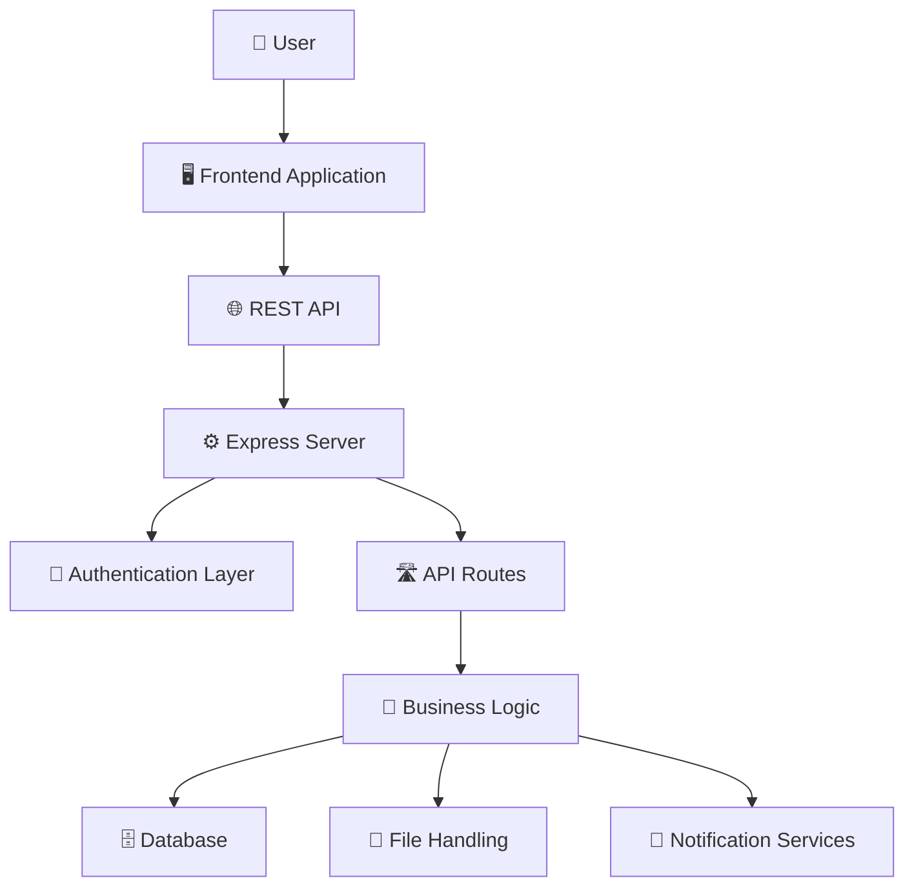
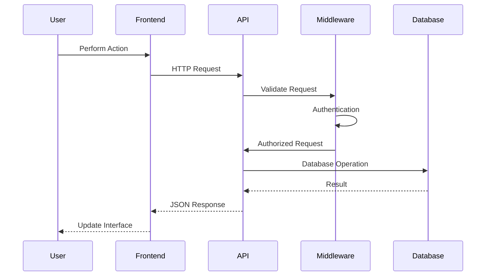
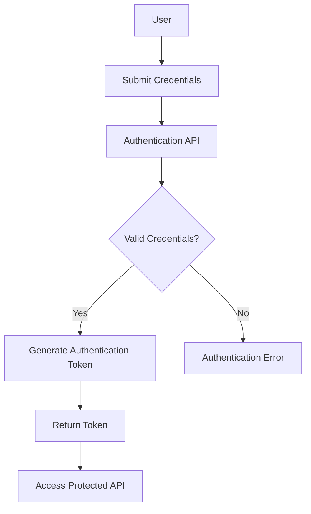
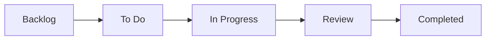
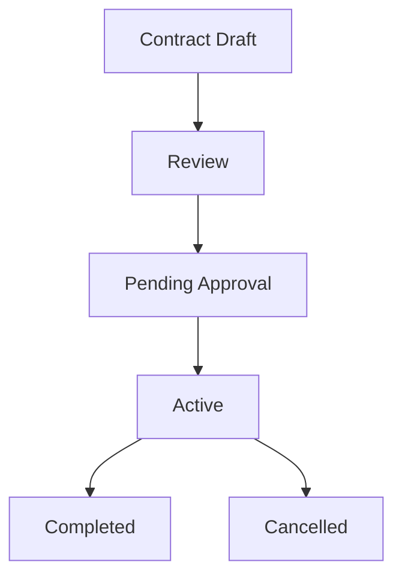
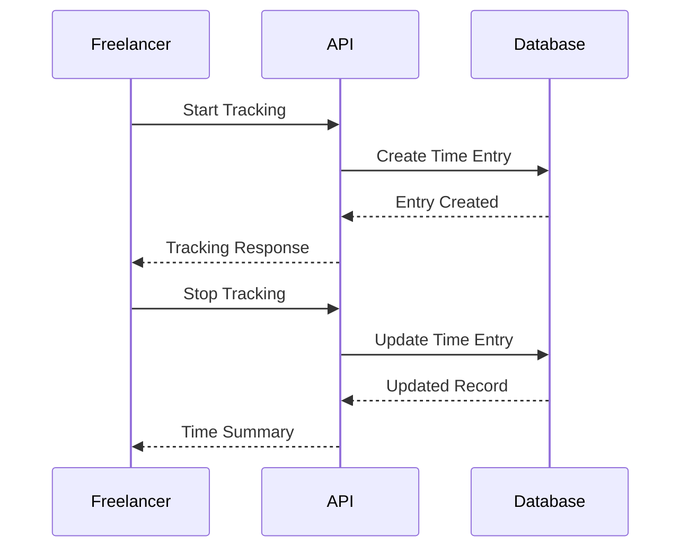
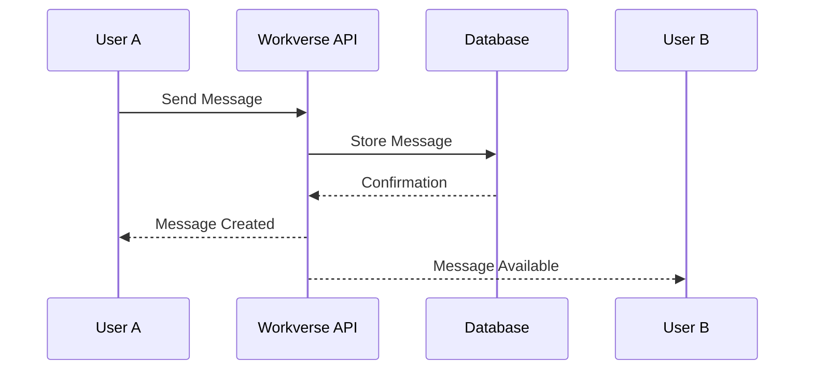
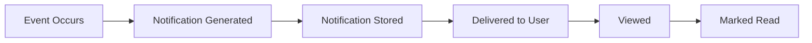
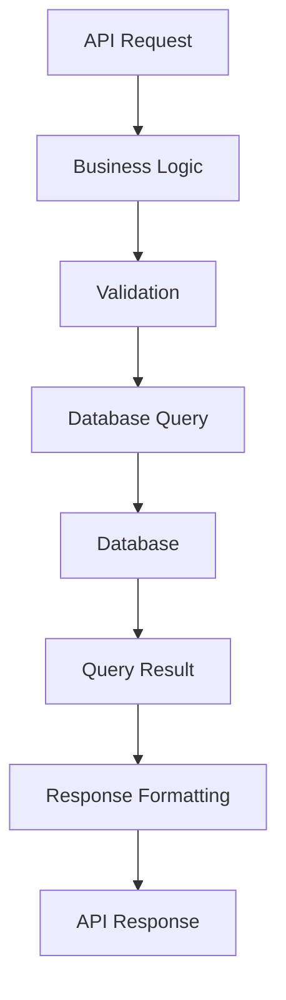
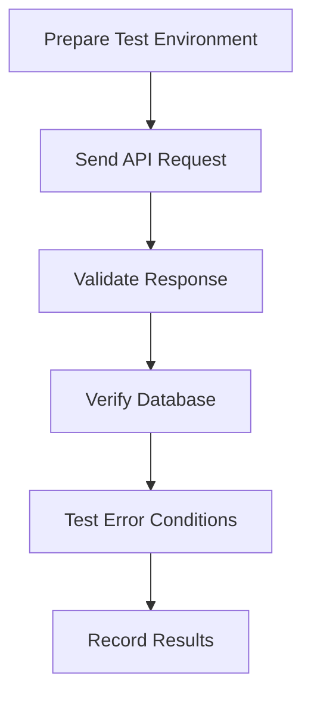

# <div align="center">❄️ WORKVERSE</div>

<div align="center">

# API DOCUMENTATION

### Developer Reference · Integration Guide · API Handbook

**Discover. Collaborate. Deliver.**

A comprehensive developer guide to the Workverse API ecosystem.

<br/>


</div>

---

<div align="center">

> **One platform. Endless possibilities.**
>
> Workverse brings clients, freelancers, projects, collaboration,
> and productivity together through a unified platform.

</div>

---

# ◈ CONTENTS

| Section | Description |
|---|---|
| [01 — Overview](#-01-overview) | Introduction to Workverse |
| [02 — Architecture](#-02-system-architecture) | Backend architecture |
| [03 — Getting Started](#-03-getting-started) | Installation and setup |
| [04 — Configuration](#-04-configuration) | Environment configuration |
| [05 — API Fundamentals](#-05-api-fundamentals) | Request and response conventions |
| [06 — Authentication](#-06-authentication) | JWT authentication |
| [07 — API Reference](#-07-api-reference) | Endpoint documentation |
| [08 — Error Handling](#-08-error-handling) | Errors and status codes |
| [09 — Integration Examples](#-09-integration-examples) | API usage examples |
| [10 — Database](#-10-database-overview) | Persistence layer |
| [11 — Security](#-11-security-guidelines) | Security considerations |
| [12 — Testing](#-12-testing) | Testing and verification |
| [13 — Project Structure](#-13-project-structure) | Code organization |
| [14 — FAQ](#-14-frequently-asked-questions) | Troubleshooting |

---

# ◈ 01. OVERVIEW

## What is Workverse?

Workverse is a collaborative freelancing and project-management platform designed to bridge the gap between clients and skilled professionals.

The platform provides an integrated environment where users can discover opportunities, manage projects, collaborate with teams, track progress, handle project workflows, and manage their professional activities.

Its backend API acts as the communication layer between the frontend application and the platform's data and business logic.

### Core objectives

- Simplify freelancer and client interaction.
- Centralize project management.
- Support collaborative workflows.
- Improve task organization and tracking.
- Facilitate communication.
- Provide structured project lifecycle management.
- Offer a scalable foundation for future platform features.

---

## ✦ Core Modules

<table>
<tr>
<td width="50%">

### 🔐 Authentication

Identity verification, user registration, login, and protected resources.

</td>
<td width="50%">

### 👥 Talent Discovery

Discover freelancers, professionals, and potential collaborators.

</td>
</tr>

<tr>
<td>

### 📁 Project Management

Create, manage, organize, and monitor projects.

</td>
<td>

### 📋 Kanban Management

Manage tasks, workflow stages, and project progress.

</td>
</tr>

<tr>
<td>

### 🤝 Contracts

Manage agreements and contractual workflows.

</td>
<td>

### 💬 Communication

Enable communication between clients and freelancers.

</td>
</tr>

<tr>
<td>

### 💰 Payment & Wallet

Support payment-related and financial workflows.

</td>
<td>

### 🔔 Notifications

Keep users informed about activities and updates.

</td>
</tr>

<tr>
<td>

### ⏱️ Time Tracking

Track work duration and project activity.

</td>
<td>

### 📎 Deliverables

Organize and manage project submissions.

</td>
</tr>
</table>

---

# ◈ 02. SYSTEM ARCHITECTURE

## High-Level Architecture



### Architecture Components

| Component | Responsibility |
|---|---|
| Frontend | User interface and interaction |
| REST API | Communication between frontend and backend |
| Express Server | HTTP request handling |
| Authentication | Identity verification and authorization |
| API Routes | Endpoint organization |
| Business Logic | Application functionality |
| Database | Persistent data storage |
| Services | Specialized operations |

---

## Request Lifecycle



### How a request works

1. A user performs an action in the frontend.
2. The frontend creates an HTTP request.
3. The request is sent to the API.
4. Middleware validates the request.
5. Authentication is checked if required.
6. The backend processes the operation.
7. The database is queried or updated.
8. The API returns a JSON response.
9. The frontend updates its interface.

---

# ◈ 03. GETTING STARTED

## Prerequisites

Before running the application, make sure the following are installed:

| Requirement | Purpose |
|---|---|
| Node.js | JavaScript runtime |
| npm | Dependency management |
| Git | Version control |
| Code Editor | Development environment |

---

## Installation

### Step 1 — Clone the repository

```bash
git clone YOUR_REPOSITORY_URL
```

### Step 2 — Navigate to the project

```bash
cd freelance-project-axlero-main
```

### Step 3 — Navigate to the backend

```bash
cd backend
```

### Step 4 — Install dependencies

```bash
npm install
```

### Step 5 — Configure environment variables

Create the required environment configuration file.

```bash
touch .env
```

Add the configuration required by the backend.

### Step 6 — Start the backend

```bash
npm start
```

---

## Local Development

Once the backend is running, the API can be accessed through the configured local server.

```text
http://localhost:5000
```

> Replace the host and port with the values configured for your environment.

---

# ◈ 04. CONFIGURATION

## Environment Variables

Environment variables allow the application to be configured without hardcoding sensitive values into the source code.

| Variable | Description |
|---|---|
| `PORT` | Port on which the backend runs |
| `JWT_SECRET` | Secret used for JWT signing and verification |
| `NODE_ENV` | Application environment |

### Example configuration

```env
PORT=5000
JWT_SECRET=replace_with_secure_secret
NODE_ENV=development
```

> ⚠️ Never expose production secrets or commit sensitive credentials to GitHub.

---

# ◈ 05. API FUNDAMENTALS

## Base URL

### Local Development

```text
http://localhost:5000
```

### API Prefix

```text
/api
```

> Confirm the exact prefix against your backend route registration.

---

## HTTP Methods

| Method | Purpose | Typical Usage |
|---|---|---|
| `GET` | Retrieve data | Fetch projects |
| `POST` | Create or execute | Create a project |
| `PUT` | Replace/update | Replace resource details |
| `PATCH` | Partially update | Update selected fields |
| `DELETE` | Remove | Delete a resource |

---

## Request Format

The API generally communicates using JSON.

```http
Content-Type: application/json
```

### Example JSON request

```json
{
  "name": "Website Development",
  "description": "Develop a modern web application"
}
```

---

## Response Format

API responses should be interpreted according to the actual response returned by each endpoint.

Example:

```json
{
  "success": true,
  "message": "Operation completed successfully",
  "data": {}
}
```

> Response structures may differ between endpoints. Refer to the individual endpoint documentation.

---

# ◈ 06. AUTHENTICATION

## Authentication Overview

Workverse uses authentication to identify users and protect resources that require access privileges.

Authentication establishes the identity of the user.

Authorization determines what the authenticated user is permitted to do.

### Authentication Flow



---

## JWT Authentication

JSON Web Tokens provide a mechanism for securely transmitting identity-related information.

A token is typically issued after successful authentication.

Protected endpoints may require the token to be included with each request.

### Authorization Header

```http
Authorization: Bearer YOUR_ACCESS_TOKEN
```

### Example

```bash
curl -X GET http://localhost:5000/api/protected-resource \
  -H "Authorization: Bearer YOUR_ACCESS_TOKEN"
```

---

## Authentication Requirements

| Request Type | Authentication |
|---|---|
| Public endpoints | Not required |
| Protected endpoints | Required |
| User-specific endpoints | Required |
| Administrative endpoints | Required with appropriate authorization |

The actual authentication requirements must be verified for each endpoint.

---

# ◈ 07. API REFERENCE

> This section should contain the exact routes, parameters, payloads,
> and responses implemented by the backend.

Endpoints are grouped according to their functional responsibilities.

---

## 🔐 7.1 AUTHENTICATION API

Authentication endpoints are responsible for user identity, registration, login, and access control.

### Available operations

| Operation | HTTP Method | Purpose |
|---|---|---|
| Registration | `POST` | Create a user account |
| Login | `POST` | Authenticate a user |
| Profile | `GET` | Retrieve profile information |
| Profile Update | `PUT/PATCH` | Update user information |
| Logout | `POST` | End authentication session, if implemented |

<details>
<summary><strong>Register User</strong></summary>

### Endpoint

```http
POST /api/auth/register
```

### Purpose

Creates a new user account.

### Request Body

```json
{
  "name": "Example User",
  "email": "user@example.com",
  "password": "your_password"
}
```

### Expected behavior

1. Validate the submitted fields.
2. Verify that the user information meets the required constraints.
3. Create the user.
4. Return an appropriate response.

> Replace the route and fields with the exact implementation from the backend.

</details>

<details>
<summary><strong>Login</strong></summary>

### Endpoint

```http
POST /api/auth/login
```

### Purpose

Authenticates an existing user.

### Request Body

```json
{
  "email": "user@example.com",
  "password": "your_password"
}
```

### Expected behavior

1. Accept the authentication credentials.
2. Verify the user.
3. Validate the password.
4. Generate an authentication token if successful.
5. Return the authentication result.

</details>

---

## 👥 7.2 TALENT DISCOVERY

Talent Discovery provides functionality for clients to discover and evaluate potential freelancers.

### Functionalities

- Freelancer discovery
- Freelancer profiles
- Skills
- Experience information
- Search and filtering
- Profile details

<details>
<summary><strong>Retrieve Talent</strong></summary>

### Endpoint

```http
GET /api/talent
```

### Purpose

Retrieve talent-related information.

### Authentication

Depends on the actual implementation.

### Query Parameters

| Parameter | Type | Description |
|---|---|---|
| `search` | String | Search query |
| `skill` | String | Filter by skill |
| `page` | Number | Pagination page |
| `limit` | Number | Number of records |

> Parameters shown above are illustrative. Document only those actually supported by your backend.

</details>

---

## 📁 7.3 PROJECT MANAGEMENT

Project Management provides the foundation for creating and managing professional projects.

### Core operations

| Operation | Purpose |
|---|---|
| Create Project | Create a new project |
| Retrieve Projects | Fetch project information |
| Update Project | Modify project details |
| Delete Project | Remove a project |
| Project Details | Retrieve individual project information |

<details>
<summary><strong>Create Project</strong></summary>

### Endpoint

```http
POST /api/projects
```

### Purpose

Creates a new project.

### Request Body

```json
{
  "title": "Web Application Development",
  "description": "Build a responsive web application",
  "budget": 5000
}
```

### Response

The API returns the result of the creation operation.

</details>

<details>
<summary><strong>Retrieve Projects</strong></summary>

### Endpoint

```http
GET /api/projects
```

### Purpose

Retrieves project information.

### Response

```json
{
  "success": true,
  "data": []
}
```

</details>

---

## 📋 7.4 KANBAN & TASK MANAGEMENT

The Kanban module provides a visual workflow for organizing tasks.

### Typical Workflow



### Functionalities

- Task creation
- Task updates
- Task assignment
- Workflow management
- Task status changes
- Project-level task organization

<details>
<summary><strong>Task Management</strong></summary>

Document task endpoints according to their actual backend implementation.

| Method | Purpose |
|---|---|
| `GET` | Retrieve tasks |
| `POST` | Create a task |
| `PUT/PATCH` | Update task |
| `DELETE` | Remove task |

</details>

---

## 🤝 7.5 CONTRACT MANAGEMENT

The Contract module handles agreements and project-related contractual information.

### Core functionalities

- Contract creation
- Contract retrieval
- Contract status
- Contract updates
- Contract lifecycle management

### Contract Lifecycle



> The lifecycle shown is conceptual. The actual statuses depend on the backend implementation.

---

## ⏱️ 7.6 TIME TRACKING

Time Tracking supports the recording and management of work associated with projects.

### Functionalities

- Track work duration
- Associate time with projects
- Retrieve work records
- Monitor work activity
- Calculate tracked time

### Typical Workflow



---

## 💰 7.7 WALLET & PAYMENTS

Financial functionality is organized around the platform's payment-related workflows.

### Core functionalities

- Wallet information
- Balance information
- Transaction history
- Payment operations
- Payment status

> Financial operations should always be verified against server-side authorization and validation.

---

## 💬 7.8 MESSAGING

Messaging enables communication between users.

### Functionalities

- Conversation management
- Message sending
- Message retrieval
- Conversation history
- User communication

### Communication Workflow



---

## 🔔 7.9 NOTIFICATIONS

The notification module keeps users informed about relevant platform activity.

### Possible notification categories

- Project updates
- Contract activity
- Task changes
- Messages
- Platform activity
- User-specific events

### Notification lifecycle



---

## 📎 7.10 DELIVERABLES

Deliverables represent work submitted or shared as part of a project.

### Functionalities

- Deliverable submission
- Deliverable retrieval
- Project association
- Submission status
- Delivery tracking

---

## 👨‍👩‍👧 7.11 TEAM MANAGEMENT

Team functionality supports collaborative work environments.

### Functionalities

- Team creation
- Team members
- Member management
- Team projects
- Collaboration workflows

---

## ⭐ 7.12 BOOKMARKS

Bookmarks enable users to save resources for future access.

### Functionalities

- Save resources
- Retrieve saved resources
- Remove bookmarks
- Manage saved items

---

# ◈ 08. ERROR HANDLING

## HTTP Status Codes

| Status Code | Name | Meaning |
|---|---|---|
| `200` | OK | Request completed successfully |
| `201` | Created | Resource successfully created |
| `204` | No Content | Successful request without response body |
| `400` | Bad Request | Invalid request |
| `401` | Unauthorized | Authentication required or invalid |
| `403` | Forbidden | Access denied |
| `404` | Not Found | Resource not found |
| `409` | Conflict | Request conflicts with current state |
| `422` | Unprocessable Entity | Validation failure |
| `429` | Too Many Requests | Rate limit exceeded |
| `500` | Internal Server Error | Server-side failure |

> Include only status codes that are actually used or handled by your application.

---

## Error Response

Example:

```json
{
  "success": false,
  "message": "Something went wrong"
}
```

Actual error formats may vary depending on the endpoint.

---

## Error Troubleshooting

| Error | Possible Cause | Resolution |
|---|---|---|
| `401 Unauthorized` | Missing or invalid token | Authenticate again |
| `403 Forbidden` | Insufficient permissions | Verify user authorization |
| `404 Not Found` | Incorrect URL or missing resource | Verify route and resource ID |
| `400 Bad Request` | Invalid payload | Check request body |
| `500 Internal Server Error` | Backend exception | Inspect server logs |

---

# ◈ 09. INTEGRATION EXAMPLES

## Example 1 — GET Request

```javascript
const response = await fetch(
  "http://localhost:5000/api/example"
);

const data = await response.json();

console.log(data);
```

---

## Example 2 — POST Request

```javascript
const response = await fetch(
  "http://localhost:5000/api/example",
  {
    method: "POST",

    headers: {
      "Content-Type": "application/json"
    },

    body: JSON.stringify({
      name: "Example"
    })
  }
);

const data = await response.json();

console.log(data);
```

---

## Example 3 — Authenticated Request

```javascript
const token = localStorage.getItem("token");

const response = await fetch(
  "http://localhost:5000/api/protected",
  {
    headers: {
      Authorization: `Bearer ${token}`
    }
  }
);

const data = await response.json();

console.log(data);
```

---

## Example 4 — Error Handling

```javascript
async function fetchData() {

  try {

    const response = await fetch(
      "http://localhost:5000/api/example"
    );

    if (!response.ok) {
      throw new Error(
        `HTTP Error: ${response.status}`
      );
    }

    const data = await response.json();

    console.log(data);

  } catch (error) {

    console.error(
      "API Request Failed:",
      error.message
    );

  }

}
```

---

# ◈ 10. DATABASE OVERVIEW

Workverse uses a persistence layer to store application information.

The database is responsible for maintaining application data such as:

- User records
- Projects
- Tasks
- Contracts
- Messages
- Notifications
- Financial records
- Teams
- Deliverables

### Database Interaction



---

# ◈ 11. SECURITY GUIDELINES

## Authentication Security

- Protect authentication credentials.
- Use secure token handling.
- Validate authentication on protected routes.
- Prevent unauthorized access.

## Input Validation

- Validate request body.
- Validate query parameters.
- Validate path parameters.
- Reject malformed requests.

## Authorization

Authentication does not automatically grant permission to access every resource.

The backend should verify that the authenticated user is authorized to perform the requested action.

## Sensitive Information

Never expose:

- Passwords
- Private credentials
- JWT signing secrets
- Internal configuration
- Sensitive user information
- Database credentials

## Production Recommendations

- Use HTTPS.
- Use secure environment variables.
- Implement appropriate rate limiting.
- Validate all incoming data.
- Use secure authentication practices.
- Maintain error logging.
- Avoid exposing internal stack traces.

---

# ◈ 12. TESTING

## Testing Objectives

API testing should verify:

- Successful requests
- Authentication
- Authorization
- Request validation
- Database interactions
- Response structure
- Error handling
- Edge cases

## Testing Workflow



## Example Test Checklist

- [ ] Registration works
- [ ] Login works
- [ ] Invalid credentials are rejected
- [ ] Protected endpoints require authentication
- [ ] Unauthorized users cannot access restricted resources
- [ ] Request validation works
- [ ] CRUD operations function correctly
- [ ] Database updates are correct
- [ ] Error responses are handled correctly

---

# ◈ 13. PROJECT STRUCTURE

The project is organized into frontend and backend components.

```text
WORKVERSE/
│
├── backend/
│   ├── routes/
│   ├── middleware/
│   ├── controllers/
│   ├── services/
│   ├── database/
│   ├── models/
│   ├── utils/
│   └── server.js
│
├── frontend/
│   ├── src/
│   │   ├── components/
│   │   ├── pages/
│   │   ├── services/
│   │   ├── hooks/
│   │   └── utils/
│   │
│   └── public/
│
├── docs/
│   └── API_DOCUMENTATION.md
│
├── README.md
│
└── package.json
```

> The tree above is illustrative. Update it to reflect the exact repository structure.

---

# ◈ 14. FREQUENTLY ASKED QUESTIONS

<details>
<summary><strong>How do I access the API locally?</strong></summary>

Start the backend server and use the configured localhost URL.

</details>

<details>
<summary><strong>Why am I receiving a 401 response?</strong></summary>

The request may be missing a valid authentication token. Check the authorization header and ensure your token is valid.

</details>

<details>
<summary><strong>Why am I receiving a 404 response?</strong></summary>

Verify the endpoint URL, route prefix, resource identifier, and HTTP method.

</details>

<details>
<summary><strong>Can I access protected endpoints without logging in?</strong></summary>

Protected endpoints require valid authentication and, where applicable, sufficient authorization.

</details>

<details>
<summary><strong>How should I handle API errors?</strong></summary>

Check the HTTP status code and response body. Use appropriate error handling in your client application.

</details>

---

# ◈ API DOCUMENTATION DISCLAIMER

This document serves as a developer reference for the Workverse API.

Endpoint availability, authentication requirements, request schemas,
response formats, and supported operations must be verified against
the current backend implementation.

---

<div align="center">

# ❄️ WORKVERSE

### Discover. Collaborate. Deliver.

**Built for modern collaboration.**

<br/>

<sub>API Documentation · Developer Reference · Workverse</sub>

<br/>


</div>
