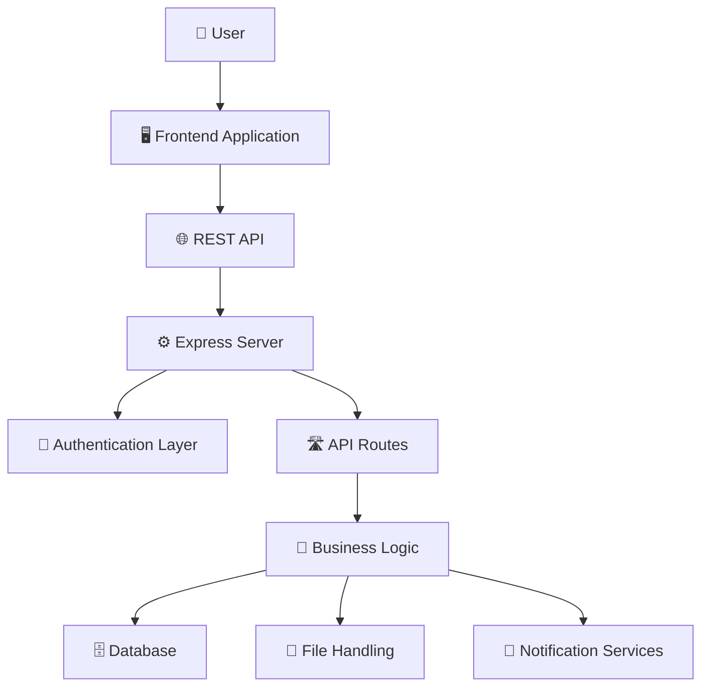
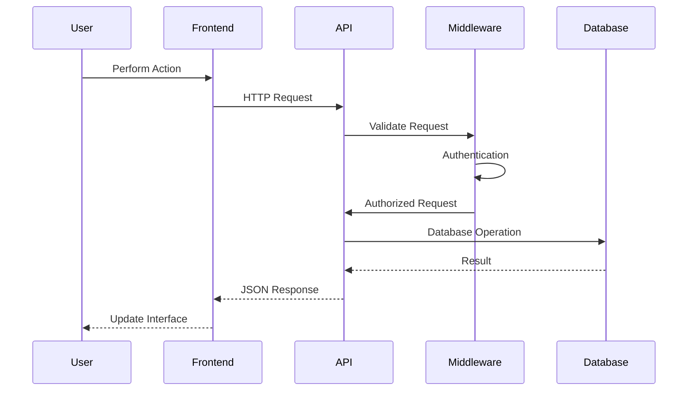
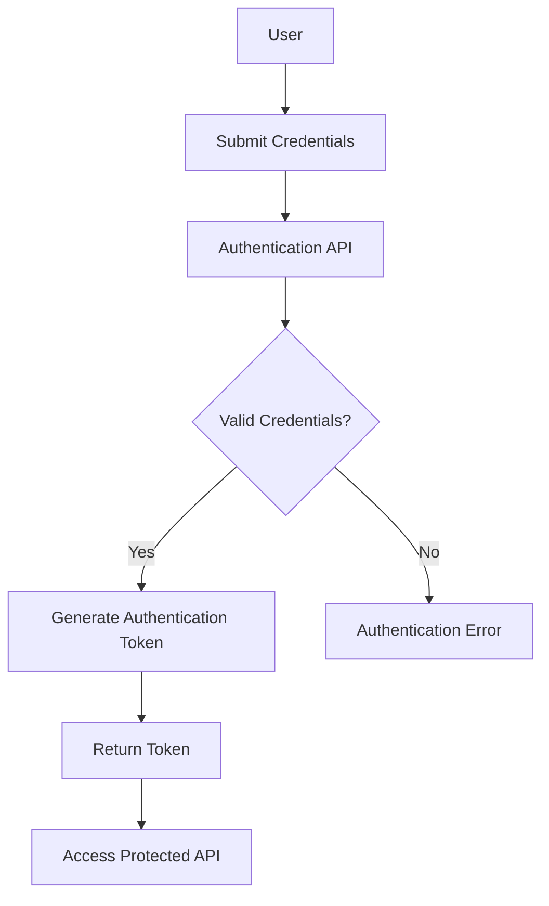
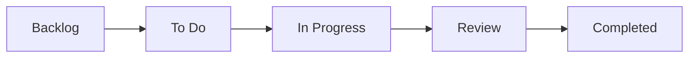
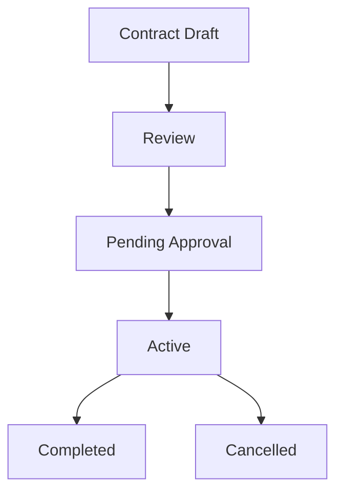
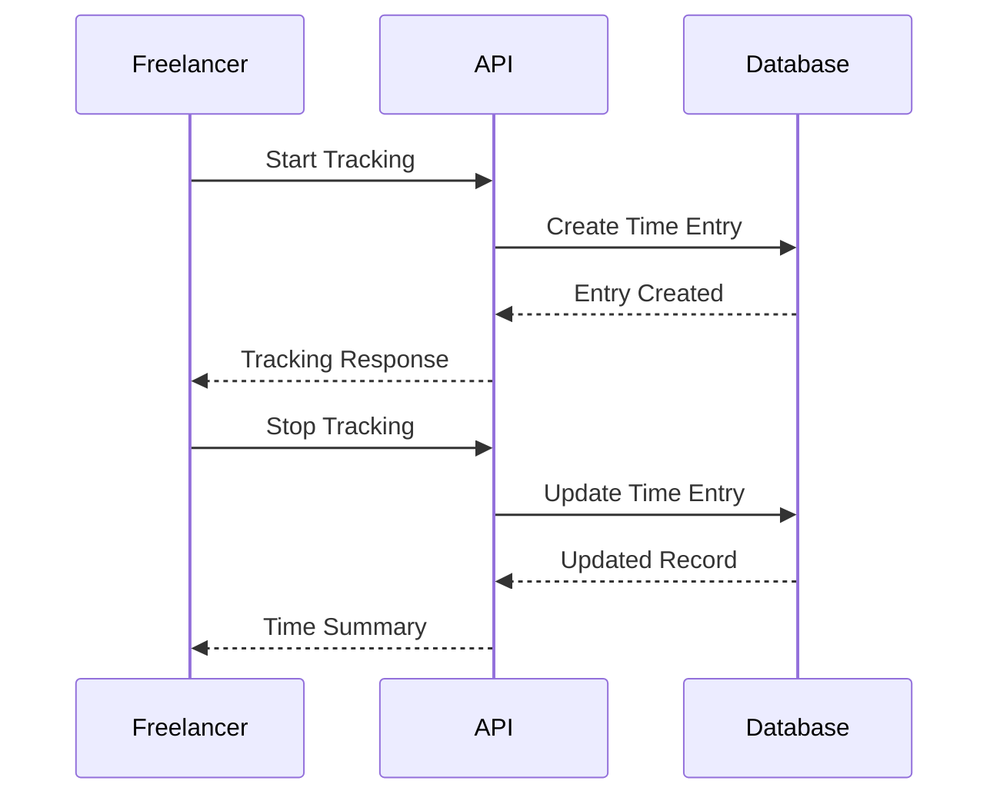
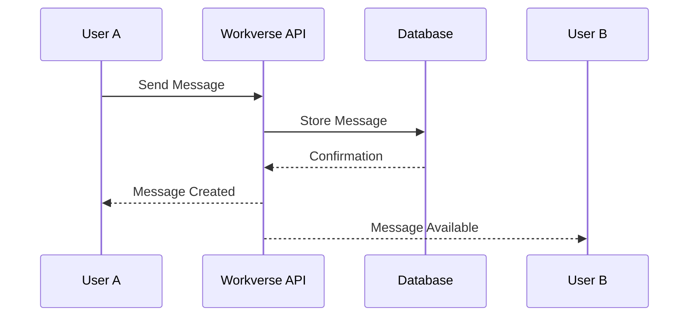
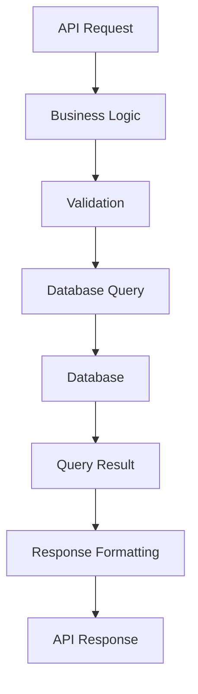
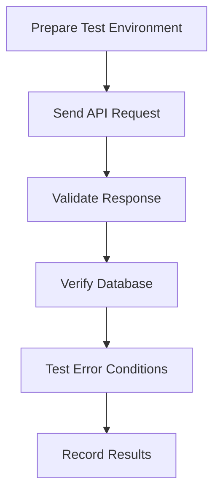

# <div align="center">❄️ WORKVERSE</div>

<div align="center">

# API DOCUMENTATION

### Developer Reference · Integration Guide · API Handbook

**Discover. Collaborate. Deliver.**

A comprehensive developer guide to the Workverse API ecosystem.

<br/>


</div>

---

<div align="center">

> **One platform. Endless possibilities.**
>
> Workverse brings clients, freelancers, projects, collaboration,
> and productivity together through a unified platform.

</div>

---

# ◈ CONTENTS

| Section | Description |
|---|---|
| [01 — Overview](#-01-overview) | Introduction to Workverse |
| [02 — Architecture](#-02-system-architecture) | Backend architecture |
| [03 — Getting Started](#-03-getting-started) | Installation and setup |
| [04 — Configuration](#-04-configuration) | Environment configuration |
| [05 — API Fundamentals](#-05-api-fundamentals) | Request and response conventions |
| [06 — Authentication](#-06-authentication) | JWT authentication |
| [07 — API Reference](#-07-api-reference) | Endpoint documentation |
| [08 — Error Handling](#-08-error-handling) | Errors and status codes |
| [09 — Integration Examples](#-09-integration-examples) | API usage examples |
| [10 — Database](#-10-database-overview) | Persistence layer |
| [11 — Security](#-11-security-guidelines) | Security considerations |
| [12 — Testing](#-12-testing) | Testing and verification |
| [13 — Project Structure](#-13-project-structure) | Code organization |
| [14 — FAQ](#-14-frequently-asked-questions) | Troubleshooting |

---

# ◈ 01. OVERVIEW

## What is Workverse?

Workverse is a collaborative freelancing and project-management platform designed to bridge the gap between clients and skilled professionals.

The platform provides an integrated environment where users can discover opportunities, manage projects, collaborate with teams, track progress, handle project workflows, and manage their professional activities.

Its backend API acts as the communication layer between the frontend application and the platform's data and business logic.

### Core objectives

- Simplify freelancer and client interaction.
- Centralize project management.
- Support collaborative workflows.
- Improve task organization and tracking.
- Facilitate communication.
- Provide structured project lifecycle management.
- Offer a scalable foundation for future platform features.

---

## ✦ Core Modules

<table>
<tr>
<td width="50%">

### 🔐 Authentication

Identity verification, user registration, login, and protected resources.

</td>
<td width="50%">

### 👥 Talent Discovery

Discover freelancers, professionals, and potential collaborators.

</td>
</tr>

<tr>
<td>

### 📁 Project Management

Create, manage, organize, and monitor projects.

</td>
<td>

### 📋 Kanban Management

Manage tasks, workflow stages, and project progress.

</td>
</tr>

<tr>
<td>

### 🤝 Contracts

Manage agreements and contractual workflows.

</td>
<td>

### 💬 Communication

Enable communication between clients and freelancers.

</td>
</tr>

<tr>
<td>

### 💰 Payment & Wallet

Support payment-related and financial workflows.

</td>
<td>

### 🔔 Notifications

Keep users informed about activities and updates.

</td>
</tr>

<tr>
<td>

### ⏱️ Time Tracking

Track work duration and project activity.

</td>
<td>

### 📎 Deliverables

Organize and manage project submissions.

</td>
</tr>
</table>

---

# ◈ 02. SYSTEM ARCHITECTURE

## High-Level Architecture



### Architecture Components

| Component | Responsibility |
|---|---|
| Frontend | User interface and interaction |
| REST API | Communication between frontend and backend |
| Express Server | HTTP request handling |
| Authentication | Identity verification and authorization |
| API Routes | Endpoint organization |
| Business Logic | Application functionality |
| Database | Persistent data storage |
| Services | Specialized operations |

---

## Request Lifecycle



### How a request works

1. A user performs an action in the frontend.
2. The frontend creates an HTTP request.
3. The request is sent to the API.
4. Middleware validates the request.
5. Authentication is checked if required.
6. The backend processes the operation.
7. The database is queried or updated.
8. The API returns a JSON response.
9. The frontend updates its interface.

---

# ◈ 03. GETTING STARTED

## Prerequisites

Before running the application, make sure the following are installed:

| Requirement | Purpose |
|---|---|
| Node.js | JavaScript runtime |
| npm | Dependency management |
| Git | Version control |
| Code Editor | Development environment |

---

## Installation

### Step 1 — Clone the repository

```bash
git clone YOUR_REPOSITORY_URL
```

### Step 2 — Navigate to the project

```bash
cd freelance-project-axlero-main
```

### Step 3 — Navigate to the backend

```bash
cd backend
```

### Step 4 — Install dependencies

```bash
npm install
```

### Step 5 — Configure environment variables

Create the required environment configuration file.

```bash
touch .env
```

Add the configuration required by the backend.

### Step 6 — Start the backend

```bash
npm start
```

---

## Local Development

Once the backend is running, the API can be accessed through the configured local server.

```text
http://localhost:5000
```

> Replace the host and port with the values configured for your environment.

---

# ◈ 04. CONFIGURATION

## Environment Variables

Environment variables allow the application to be configured without hardcoding sensitive values into the source code.

| Variable | Description |
|---|---|
| `PORT` | Port on which the backend runs |
| `JWT_SECRET` | Secret used for JWT signing and verification |
| `NODE_ENV` | Application environment |

### Example configuration

```env
PORT=5000
JWT_SECRET=replace_with_secure_secret
NODE_ENV=development
```

> ⚠️ Never expose production secrets or commit sensitive credentials to GitHub.

---

# ◈ 05. API FUNDAMENTALS

## Base URL

### Local Development

```text
http://localhost:5000
```

### API Prefix

```text
/api
```

> Confirm the exact prefix against your backend route registration.

---

## HTTP Methods

| Method | Purpose | Typical Usage |
|---|---|---|
| `GET` | Retrieve data | Fetch projects |
| `POST` | Create or execute | Create a project |
| `PUT` | Replace/update | Replace resource details |
| `PATCH` | Partially update | Update selected fields |
| `DELETE` | Remove | Delete a resource |

---

## Request Format

The API generally communicates using JSON.

```http
Content-Type: application/json
```

### Example JSON request

```json
{
  "name": "Website Development",
  "description": "Develop a modern web application"
}
```

---

## Response Format

API responses should be interpreted according to the actual response returned by each endpoint.

Example:

```json
{
  "success": true,
  "message": "Operation completed successfully",
  "data": {}
}
```

> Response structures may differ between endpoints. Refer to the individual endpoint documentation.

---

# ◈ 06. AUTHENTICATION

## Authentication Overview

Workverse uses authentication to identify users and protect resources that require access privileges.

Authentication establishes the identity of the user.

Authorization determines what the authenticated user is permitted to do.

### Authentication Flow



---

## JWT Authentication

JSON Web Tokens provide a mechanism for securely transmitting identity-related information.

A token is typically issued after successful authentication.

Protected endpoints may require the token to be included with each request.

### Authorization Header

```http
Authorization: Bearer YOUR_ACCESS_TOKEN
```

### Example

```bash
curl -X GET http://localhost:5000/api/protected-resource \
  -H "Authorization: Bearer YOUR_ACCESS_TOKEN"
```

---

## Authentication Requirements

| Request Type | Authentication |
|---|---|
| Public endpoints | Not required |
| Protected endpoints | Required |
| User-specific endpoints | Required |
| Administrative endpoints | Required with appropriate authorization |

The actual authentication requirements must be verified for each endpoint.

---

# ◈ 07. API REFERENCE

> This section should contain the exact routes, parameters, payloads,
> and responses implemented by the backend.

Endpoints are grouped according to their functional responsibilities.

---

## 🔐 7.1 AUTHENTICATION API

Authentication endpoints are responsible for user identity, registration, login, and access control.

### Available operations

| Operation | HTTP Method | Purpose |
|---|---|---|
| Registration | `POST` | Create a user account |
| Login | `POST` | Authenticate a user |
| Profile | `GET` | Retrieve profile information |
| Profile Update | `PUT/PATCH` | Update user information |
| Logout | `POST` | End authentication session, if implemented |

<details>
<summary><strong>Register User</strong></summary>

### Endpoint

```http
POST /api/auth/register
```

### Purpose

Creates a new user account.

### Request Body

```json
{
  "name": "Example User",
  "email": "user@example.com",
  "password": "your_password"
}
```

### Expected behavior

1. Validate the submitted fields.
2. Verify that the user information meets the required constraints.
3. Create the user.
4. Return an appropriate response.

> Replace the route and fields with the exact implementation from the backend.

</details>

<details>
<summary><strong>Login</strong></summary>

### Endpoint

```http
POST /api/auth/login
```

### Purpose

Authenticates an existing user.

### Request Body

```json
{
  "email": "user@example.com",
  "password": "your_password"
}
```

### Expected behavior

1. Accept the authentication credentials.
2. Verify the user.
3. Validate the password.
4. Generate an authentication token if successful.
5. Return the authentication result.

</details>

---

## 👥 7.2 TALENT DISCOVERY

Talent Discovery provides functionality for clients to discover and evaluate potential freelancers.

### Functionalities

- Freelancer discovery
- Freelancer profiles
- Skills
- Experience information
- Search and filtering
- Profile details

<details>
<summary><strong>Retrieve Talent</strong></summary>

### Endpoint

```http
GET /api/talent
```

### Purpose

Retrieve talent-related information.

### Authentication

Depends on the actual implementation.

### Query Parameters

| Parameter | Type | Description |
|---|---|---|
| `search` | String | Search query |
| `skill` | String | Filter by skill |
| `page` | Number | Pagination page |
| `limit` | Number | Number of records |

> Parameters shown above are illustrative. Document only those actually supported by your backend.

</details>

---

## 📁 7.3 PROJECT MANAGEMENT

Project Management provides the foundation for creating and managing professional projects.

### Core operations

| Operation | Purpose |
|---|---|
| Create Project | Create a new project |
| Retrieve Projects | Fetch project information |
| Update Project | Modify project details |
| Delete Project | Remove a project |
| Project Details | Retrieve individual project information |

<details>
<summary><strong>Create Project</strong></summary>

### Endpoint

```http
POST /api/projects
```

### Purpose

Creates a new project.

### Request Body

```json
{
  "title": "Web Application Development",
  "description": "Build a responsive web application",
  "budget": 5000
}
```

### Response

The API returns the result of the creation operation.

</details>

<details>
<summary><strong>Retrieve Projects</strong></summary>

### Endpoint

```http
GET /api/projects
```

### Purpose

Retrieves project information.

### Response

```json
{
  "success": true,
  "data": []
}
```

</details>

---

## 📋 7.4 KANBAN & TASK MANAGEMENT

The Kanban module provides a visual workflow for organizing tasks.

### Typical Workflow



### Functionalities

- Task creation
- Task updates
- Task assignment
- Workflow management
- Task status changes
- Project-level task organization

<details>
<summary><strong>Task Management</strong></summary>

Document task endpoints according to their actual backend implementation.

| Method | Purpose |
|---|---|
| `GET` | Retrieve tasks |
| `POST` | Create a task |
| `PUT/PATCH` | Update task |
| `DELETE` | Remove task |

</details>

---

## 🤝 7.5 CONTRACT MANAGEMENT

The Contract module handles agreements and project-related contractual information.

### Core functionalities

- Contract creation
- Contract retrieval
- Contract status
- Contract updates
- Contract lifecycle management

### Contract Lifecycle



> The lifecycle shown is conceptual. The actual statuses depend on the backend implementation.

---

## ⏱️ 7.6 TIME TRACKING

Time Tracking supports the recording and management of work associated with projects.

### Functionalities

- Track work duration
- Associate time with projects
- Retrieve work records
- Monitor work activity
- Calculate tracked time

### Typical Workflow



---

## 💰 7.7 WALLET & PAYMENTS

Financial functionality is organized around the platform's payment-related workflows.

### Core functionalities

- Wallet information
- Balance information
- Transaction history
- Payment operations
- Payment status

> Financial operations should always be verified against server-side authorization and validation.

---

## 💬 7.8 MESSAGING

Messaging enables communication between users.

### Functionalities

- Conversation management
- Message sending
- Message retrieval
- Conversation history
- User communication

### Communication Workflow



---

## 🔔 7.9 NOTIFICATIONS

The notification module keeps users informed about relevant platform activity.

### Possible notification categories

- Project updates
- Contract activity
- Task changes
- Messages
- Platform activity
- User-specific events

### Notification lifecycle


---

## 📎 7.10 DELIVERABLES

Deliverables represent work submitted or shared as part of a project.

### Functionalities

- Deliverable submission
- Deliverable retrieval
- Project association
- Submission status
- Delivery tracking

---

## 👨‍👩‍👧 7.11 TEAM MANAGEMENT

Team functionality supports collaborative work environments.

### Functionalities

- Team creation
- Team members
- Member management
- Team projects
- Collaboration workflows

---

## ⭐ 7.12 BOOKMARKS

Bookmarks enable users to save resources for future access.

### Functionalities

- Save resources
- Retrieve saved resources
- Remove bookmarks
- Manage saved items

---

# ◈ 08. ERROR HANDLING

## HTTP Status Codes

| Status Code | Name | Meaning |
|---|---|---|
| `200` | OK | Request completed successfully |
| `201` | Created | Resource successfully created |
| `204` | No Content | Successful request without response body |
| `400` | Bad Request | Invalid request |
| `401` | Unauthorized | Authentication required or invalid |
| `403` | Forbidden | Access denied |
| `404` | Not Found | Resource not found |
| `409` | Conflict | Request conflicts with current state |
| `422` | Unprocessable Entity | Validation failure |
| `429` | Too Many Requests | Rate limit exceeded |
| `500` | Internal Server Error | Server-side failure |

> Include only status codes that are actually used or handled by your application.

---

## Error Response

Example:

```json
{
  "success": false,
  "message": "Something went wrong"
}
```

Actual error formats may vary depending on the endpoint.

---

## Error Troubleshooting

| Error | Possible Cause | Resolution |
|---|---|---|
| `401 Unauthorized` | Missing or invalid token | Authenticate again |
| `403 Forbidden` | Insufficient permissions | Verify user authorization |
| `404 Not Found` | Incorrect URL or missing resource | Verify route and resource ID |
| `400 Bad Request` | Invalid payload | Check request body |
| `500 Internal Server Error` | Backend exception | Inspect server logs |

---

# ◈ 09. INTEGRATION EXAMPLES

## Example 1 — GET Request

```javascript
const response = await fetch(
  "http://localhost:5000/api/example"
);

const data = await response.json();

console.log(data);
```

---

## Example 2 — POST Request

```javascript
const response = await fetch(
  "http://localhost:5000/api/example",
  {
    method: "POST",

    headers: {
      "Content-Type": "application/json"
    },

    body: JSON.stringify({
      name: "Example"
    })
  }
);

const data = await response.json();

console.log(data);
```

---

## Example 3 — Authenticated Request

```javascript
const token = localStorage.getItem("token");

const response = await fetch(
  "http://localhost:5000/api/protected",
  {
    headers: {
      Authorization: `Bearer ${token}`
    }
  }
);

const data = await response.json();

console.log(data);
```

---

## Example 4 — Error Handling

```javascript
async function fetchData() {

  try {

    const response = await fetch(
      "http://localhost:5000/api/example"
    );

    if (!response.ok) {
      throw new Error(
        `HTTP Error: ${response.status}`
      );
    }

    const data = await response.json();

    console.log(data);

  } catch (error) {

    console.error(
      "API Request Failed:",
      error.message
    );

  }

}
```

---

# ◈ 10. DATABASE OVERVIEW

Workverse uses a persistence layer to store application information.

The database is responsible for maintaining application data such as:

- User records
- Projects
- Tasks
- Contracts
- Messages
- Notifications
- Financial records
- Teams
- Deliverables

### Database Interaction



---

# ◈ 11. SECURITY GUIDELINES

## Authentication Security

- Protect authentication credentials.
- Use secure token handling.
- Validate authentication on protected routes.
- Prevent unauthorized access.

## Input Validation

- Validate request body.
- Validate query parameters.
- Validate path parameters.
- Reject malformed requests.

## Authorization

Authentication does not automatically grant permission to access every resource.

The backend should verify that the authenticated user is authorized to perform the requested action.

## Sensitive Information

Never expose:

- Passwords
- Private credentials
- JWT signing secrets
- Internal configuration
- Sensitive user information
- Database credentials

## Production Recommendations

- Use HTTPS.
- Use secure environment variables.
- Implement appropriate rate limiting.
- Validate all incoming data.
- Use secure authentication practices.
- Maintain error logging.
- Avoid exposing internal stack traces.

---

# ◈ 12. TESTING

## Testing Objectives

API testing should verify:

- Successful requests
- Authentication
- Authorization
- Request validation
- Database interactions
- Response structure
- Error handling
- Edge cases

## Testing Workflow



## Example Test Checklist

- [ ] Registration works
- [ ] Login works
- [ ] Invalid credentials are rejected
- [ ] Protected endpoints require authentication
- [ ] Unauthorized users cannot access restricted resources
- [ ] Request validation works
- [ ] CRUD operations function correctly
- [ ] Database updates are correct
- [ ] Error responses are handled correctly

---

# ◈ 13. PROJECT STRUCTURE

The project is organized into frontend and backend components.

```text
WORKVERSE/
│
├── backend/
│   ├── routes/
│   ├── middleware/
│   ├── controllers/
│   ├── services/
│   ├── database/
│   ├── models/
│   ├── utils/
│   └── server.js
│
├── frontend/
│   ├── src/
│   │   ├── components/
│   │   ├── pages/
│   │   ├── services/
│   │   ├── hooks/
│   │   └── utils/
│   │
│   └── public/
│
├── docs/
│   └── API_DOCUMENTATION.md
│
├── README.md
│
└── package.json
```

> The tree above is illustrative. Update it to reflect the exact repository structure.

---

# ◈ 14. FREQUENTLY ASKED QUESTIONS

<details>
<summary><strong>How do I access the API locally?</strong></summary>

Start the backend server and use the configured localhost URL.

</details>

<details>
<summary><strong>Why am I receiving a 401 response?</strong></summary>

The request may be missing a valid authentication token. Check the authorization header and ensure your token is valid.

</details>

<details>
<summary><strong>Why am I receiving a 404 response?</strong></summary>

Verify the endpoint URL, route prefix, resource identifier, and HTTP method.

</details>

<details>
<summary><strong>Can I access protected endpoints without logging in?</strong></summary>

Protected endpoints require valid authentication and, where applicable, sufficient authorization.

</details>

<details>
<summary><strong>How should I handle API errors?</strong></summary>

Check the HTTP status code and response body. Use appropriate error handling in your client application.

</details>

---

# ◈ API DOCUMENTATION DISCLAIMER

This document serves as a developer reference for the Workverse API.

Endpoint availability, authentication requirements, request schemas,
response formats, and supported operations must be verified against
the current backend implementation.

---

<div align="center">

# ❄️ WORKVERSE

### Discover. Collaborate. Deliver.

**Built for modern collaboration.**

<br/>

<sub>API Documentation · Developer Reference · Workverse</sub>

<br/>


</div>

---

# ◈ 15. COMPLETE API ENDPOINT DIRECTORY

This section provides a consolidated reference of the API routes currently exposed by the Workverse backend. It complements the module walkthrough above by making it easier to locate an endpoint, understand its access requirements, and identify the operation it performs.

> **Important:** This directory reflects the route handlers implemented in `backend/server.js`. The endpoint names, HTTP methods, and authentication requirements below are based on the current backend code.

## ✦ Endpoint Summary

| Module | Method | Endpoint | Access |
|---|---|---|---|
| System | GET | `/` | Public |
| System | GET | `/api` | Public |
| System | GET | `/api/health` | Public |
| System | GET | `/api/system/metrics` | Public |
| System | GET | `/api/stats` | Public |
| Documentation | GET | `/docs`, `/docs/`, `/api/docs`, `/api-docs`, `/swagger` | Public |
| Documentation | GET | `/openapi.json`, `/api/openapi.json` | Public |
| Authentication | POST | `/api/auth/register` | Public / rate-limited |
| Authentication | POST | `/api/auth/login` | Public / rate-limited |
| Authentication | GET | `/api/auth/me` | JWT required |
| Authentication | POST | `/api/auth/forgot-password` | Public / rate-limited |
| Settings | GET | `/api/settings` | Public route in current implementation |
| Settings | PUT | `/api/settings` | JWT required |
| Talent | GET | `/api/talents` | Public |
| Talent | GET | `/api/talents/:id` | Public |
| Projects | GET | `/api/projects` | Public |
| Projects | GET | `/api/projects/:id` | Public |
| Projects | POST | `/api/projects` | JWT required |
| Projects | PATCH | `/api/projects/:id` | JWT required |
| Projects | DELETE | `/api/projects/:id` | JWT required |
| Kanban | GET | `/api/kanban` | JWT required |
| Kanban | POST | `/api/kanban` | JWT required |
| Kanban | PATCH | `/api/kanban/:id/column` | JWT required |
| Kanban | DELETE | `/api/kanban/:id` | JWT required |
| Contracts | GET | `/api/contracts` | JWT required |
| Contracts | POST | `/api/contracts` | JWT required |
| Proposals | GET | `/api/proposals` | JWT required |
| Proposals | POST | `/api/proposals` | JWT required |
| Proposals | PATCH | `/api/proposals/:id/status` | JWT required |
| Time tracking | POST | `/api/time/log` | JWT required |
| Time tracking | GET | `/api/time/logs` | JWT required |
| Wallet | GET | `/api/wallet` | JWT required |
| Wallet | POST | `/api/wallet/withdraw` | JWT required |
| Messages | GET | `/api/messages` | JWT required |
| Messages | POST | `/api/messages` | JWT required |
| Files | GET | `/api/files` | JWT required |
| Files | POST | `/api/files` | JWT required |
| Files | DELETE | `/api/files/:id` | JWT required |
| Team | GET | `/api/team` | JWT required |
| Team | POST | `/api/team` | JWT required |
| Payments | GET | `/api/payments` | JWT required |
| Payments | PATCH | `/api/payments/:id/release` | JWT required |
| Pricing | GET | `/api/pricing` | Public |
| Subscriptions | POST | `/api/subscriptions` | JWT required |
| Resources | GET | `/api/resources` | Public |
| Bookmarks | GET | `/api/bookmarks` | JWT required |
| Bookmarks | POST | `/api/bookmarks/toggle` | JWT required |
| Newsletter | POST | `/api/newsletter` | Public |
| Search | GET | `/api/search` | Public |
| Notifications | GET | `/api/notifications` | JWT required |
| Notifications | PATCH | `/api/notifications/read-all` | JWT required |
| Notifications | PATCH | `/api/notifications/:id/read` | JWT required |
| Notifications | DELETE | `/api/notifications/:id` | JWT required |
| Export | GET | `/api/workspace/export` | Public route in current implementation |
| Finance Export | GET | `/api/finances/export` | Public route in current implementation |
| Audit Logs | GET | `/api/audit-logs` | Public route in current implementation |
| Audit Logs | POST | `/api/audit-logs` | Public route in current implementation |

---

# ◈ 16. SYSTEM & SERVICE ENDPOINTS

## 16.1 Root Service Information

### `GET /`

Returns service metadata and database statistics. If the request accepts HTML, the server responds with the dashboard view; otherwise, a JSON service response is returned.

**Response information includes:**
- Service name
- Documentation URL
- OpenAPI specification URL
- Database statistics

## 16.2 API Information

### `GET /api`

Provides a JSON overview of the API, documentation locations, and database statistics. This endpoint is useful for quick discovery when integrating a client.

## 16.3 Health Check

### `GET /api/health`

Checks whether the backend is responding and whether SQLite can execute a basic database query.

**Response fields:** `status`, `database`, `message`, `port`, `uptimeSeconds`, and `timestamp`.

A successful health check indicates that the server is reachable and its database ping completed successfully.

## 16.4 System Telemetry

### `GET /api/system/metrics`

Returns operational metrics for the running Node.js process and database.

| Field | Description |
|---|---|
| `uptime.seconds` | Process uptime in seconds |
| `uptime.formatted` | Human-readable uptime |
| `memory.rssMB` | Resident memory size in MB |
| `memory.heapTotalMB` | Allocated JavaScript heap in MB |
| `memory.heapUsedMB` | Heap currently used in MB |
| `memory.externalMB` | External memory usage in MB |
| `system.platform` | Operating system platform |
| `system.arch` | CPU architecture |
| `system.nodeVersion` | Node.js runtime version |
| `system.pid` | Process identifier |
| `database.engine` | SQLite engine and persistence mode |
| `database.healthy` | Database ping result |
| `timestamp` | Metric collection time |

## 16.5 Database Statistics

### `GET /api/stats`

Returns the database statistics calculated by the backend, including row-count information for supported tables. Use this endpoint for administrative or dashboard-level summaries rather than retrieving individual records.


---

# ◈ 17. AUTHENTICATION & ACCOUNT WORKFLOWS

## 17.1 Registration

### `POST /api/auth/register`

Creates a user account.

**Request body**

```json
{
  "name": "Riya Kapoor",
  "email": "riya@example.com",
  "password": "password123",
  "role": "freelancer"
}
```

**Validation rules currently applied**
- `name` must be present and non-empty.
- `email` must contain an `@` character.
- `password` must contain at least six characters.
- `role` must be `client` or `freelancer`; when omitted, it defaults to `client`.
- Email is trimmed and normalized to lowercase before storage.

**Expected outcomes**
- `201 Created` when account creation succeeds.
- `400 Bad Request` when validation fails.
- `409 Conflict` when the email is already registered.
- `429 Too Many Requests` when the authentication rate limiter blocks the request.

## 17.2 Login

### `POST /api/auth/login`

Authenticates the supplied credentials and returns a JWT token for subsequent protected calls.


**Request body**

```json
{
  "email": "riya@example.com",
  "password": "password123",
  "role": "freelancer"
}
```

The client should store the returned token securely and attach it to protected requests as a Bearer token. Login attempts are rate-limited.

## 17.3 Current User

### `GET /api/auth/me`

Requires a valid JWT. Returns the authenticated account/profile information associated with the token. This endpoint is useful when restoring a session after a page refresh.

## 17.4 Password Reset Request

### `POST /api/auth/forgot-password`

Accepts an email address and queues or records a password-reset verification request. This route is rate-limited. The current API documents a reset-request workflow; clients should not assume a password is changed directly by this endpoint.

**Request body**

```json
{
  "email": "riya@example.com"
}
```

## 17.5 Settings

### `GET /api/settings`

Returns the current settings object used by the application.

### `PUT /api/settings`

Updates workspace and notification preferences. The route requires JWT authentication.

**Example request**

```json
{
  "workspaceName": "Workverse Studio",
  "billingEmail": "billing@example.com",
  "autoEscrowRelease": true,
}
```

Settings may include workspace identity, billing preferences, notification behavior, and related configuration supported by the backend. Send only fields supported by the current implementation.

---

# ◈ 18. TALENT & PROJECT DISCOVERY

## 18.1 Talent Directory

### `GET /api/talents`

Returns the talent directory. Optional query parameters can narrow the result:

| Parameter | Description |
|---|---|
| `search` | Search term used to filter talent results |
| `category` | Category or specialization filter |

**Example**

```http
GET /api/talents?search=design&category=UI%2FUX
```

## 18.2 Talent Profile

### `GET /api/talents/:id`

Returns the talent profile matching the supplied identifier. If no matching profile is available, the endpoint returns a not-found response.

## 18.3 Project Directory

### `GET /api/projects`

Returns project listings. Query parameters support filtering:

| Parameter | Description |
|---|---|
| `status` | Filter by project status; defaults to the API's all-status view |
| `search` | Search project text/details |

## 18.4 Project Details

### `GET /api/projects/:id`

Returns a single project by identifier, including its project details and related data provided by the backend.

## 18.5 Create Project

### `POST /api/projects`

Creates a project listing. Authentication is required.

**Example request**

```json
{
  "title": "Realtime Telemetry API",
  "category": "Web Development",
  "description": "Build a telemetry service for a web application.",
  "budget": "$2,400",
}
```

The server validates and creates the project using the supplied project brief information. A successful creation returns the created project and a `201`-style response.

## 18.6 Update Project

### `PATCH /api/projects/:id`

Updates supported properties of an existing project. Authentication is required. Use the project identifier in the URL and include the fields to be changed in the JSON body.

## 18.7 Delete Project

### `DELETE /api/projects/:id`

Deletes a project record identified by its ID. Authentication is required. Clients should refresh their project list after a successful deletion.


---

# ◈ 19. KANBAN & DELIVERY WORKFLOW

## 19.1 Retrieve Kanban Cards

### `GET /api/kanban`

Returns the Kanban cards available to the authenticated workspace. Authentication is required.

## 19.2 Create Kanban Card

### `POST /api/kanban`

Creates a new task card.

**Example request**

```json
{
  "title": "Implement authentication flow",
  "projectId": "project-001",
  "column": "To Do",
  "priority": "High"
}
```

The exact accepted fields depend on the task creation handler. Include the title and only properties supported by the backend.

## 19.3 Move Card Between Columns

### `PATCH /api/kanban/:id/column`

Updates the column or workflow stage for the specified card. This endpoint is intended for Kanban drag-and-drop interactions.

**Example request**

```json
{
  "column": "In Progress"
}
```

## 19.4 Delete Card

### `DELETE /api/kanban/:id`

Removes a Kanban card by ID. Authentication is required.

---

# ◈ 20. CONTRACTS, PROPOSALS & HIRING

## 20.1 Contracts

### `GET /api/contracts`

Returns contract records available to the authenticated user/workspace.

### `POST /api/contracts`

Creates a contract or hiring agreement from the submitted contract details. The endpoint is protected by JWT authentication. Ensure that the request contains the contract fields required by the backend handler.

## 20.2 Proposals

### `GET /api/proposals`

Returns proposal records for the authenticated workspace.

### `POST /api/proposals`

Creates a proposal submission. The request body should contain the proposal details accepted by the current server handler.

## 20.3 Proposal Status

### `PATCH /api/proposals/:id/status`

Updates the status of an existing proposal. Use the proposal ID in the route and the status value in the JSON request body. Authentication is required.


---

# ◈ 21. TIME TRACKING

## 21.1 Create Time Log

### `POST /api/time/log`

Creates a time-log entry for an authenticated user. This is used to persist tracked work sessions.

## 21.2 Retrieve Time Logs

### `GET /api/time/logs`

Returns time-log entries for the authenticated workspace/user context. Use this endpoint to populate activity history, timesheets, and reporting screens.

---

# ◈ 22. WALLET, PAYMENTS & WITHDRAWALS

## 22.1 Wallet Summary

### `GET /api/wallet`

Returns wallet information associated with the authenticated account, including balance and related wallet data provided by the backend.

## 22.2 Withdrawal Request

### `POST /api/wallet/withdraw`

Submits a withdrawal request. Authentication is required. The backend validates the request and updates or records the withdrawal according to its current implementation.

## 22.3 Payment Records

### `GET /api/payments`

Returns payment records associated with the authenticated context.

## 22.4 Release Escrow Payment

### `PATCH /api/payments/:id/release`

Releases the payment or escrow amount associated with the payment record. This operation is protected by JWT authentication and should be performed only when the relevant delivery/payment workflow is ready for release.


---

# ◈ 23. MESSAGING, FILES & TEAM COLLABORATION

## 23.1 Messages

### `GET /api/messages`

Returns message records for the authenticated user/workspace. The frontend can use this to load the conversation view.

### `POST /api/messages`

Creates or sends a message. Authentication is required. The JSON request must include the message content and relevant recipient/conversation information accepted by the server.

## 23.2 Files & Deliverables

### `GET /api/files`

Returns file/deliverable metadata available to the authenticated workspace.

### `POST /api/files`

Creates a file/deliverable record. The current endpoint is protected; it should not be assumed to upload arbitrary binary file content unless the implementation explicitly supports that payload.

### `DELETE /api/files/:id`

Deletes the specified file/deliverable record. Authentication is required.

## 23.3 Team

### `GET /api/team`

Returns team members or team records for the authenticated context.

### `POST /api/team`

Adds a team record/member using the fields supported by the backend handler. Authentication is required.

---

# ◈ 24. PLATFORM CATALOG & SUBSCRIPTIONS

## 24.1 Pricing

### `GET /api/pricing`

Returns pricing plan/catalog information. This endpoint is public and can be used to render the pricing page.

## 24.2 Subscription

### `POST /api/subscriptions`

Creates a subscription record or initiates the subscription workflow for the authenticated account. Authentication is required.

## 24.3 Resources

### `GET /api/resources`

Returns the platform resources/catalog entries. The endpoint can be used to populate resource discovery pages.

## 24.4 Bookmarks

### `GET /api/bookmarks`

Returns the authenticated user's bookmarked items.

### `POST /api/bookmarks/toggle`

Adds or removes a bookmark based on the item details supplied to the endpoint. Authentication is required. The frontend should interpret the response as the updated bookmark state rather than blindly adding a duplicate.

## 24.5 Newsletter

### `POST /api/newsletter`

Accepts newsletter subscription information. This route is public; validate user-provided email input on the client and handle server validation errors.

---

# ◈ 25. SEARCH & NOTIFICATIONS

## 25.1 Unified Search

### `GET /api/search`

Searches across supported platform content such as talents, projects, and resources.

| Parameter | Description |
|---|---|
| `q` | Search keyword or phrase |

**Example**

```http
GET /api/search?q=react
```

## 25.2 Notifications

### `GET /api/notifications`

Returns notifications associated with the authenticated user.

### `PATCH /api/notifications/read-all`

Marks all notifications in the authenticated context as read.

### `PATCH /api/notifications/:id/read`

Marks one notification as read.

### `DELETE /api/notifications/:id`

Deletes a notification by ID.

Notifications should be fetched after authentication and refreshed after relevant actions. The read endpoints allow the client to keep the notification UI synchronized with backend state.

---

# ◈ 26. WORKSPACE EXPORT

## 26.1 Export Workspace Data

### `GET /api/workspace/export`

Provides the workspace export response as implemented by the backend. Clients should handle the returned content type and response body appropriately. This endpoint is currently not protected by the authentication middleware in the route declaration, so integrations should treat the export as sensitive and avoid exposing it publicly through a frontend proxy or shared link.

---

# ◈ 27. REQUEST & RESPONSE EXAMPLES

The following examples demonstrate the standard request structure used by the API. Replace the base URL, identifiers, and values with those belonging to your environment.

## 27.1 Authenticated Request

```bash
curl -X GET http://localhost:5000/api/auth/me \
  -H "Authorization: Bearer YOUR_JWT_TOKEN" \
  -H "Accept: application/json"
```

## 27.2 Create a Project

```bash
curl -X POST http://localhost:5000/api/projects \
  -H "Authorization: Bearer YOUR_JWT_TOKEN" \
  -H "Content-Type: application/json" \
  -d '{
    "title": "Realtime Telemetry API",
    "category": "Web Development",
    "description": "Build a telemetry service for a web application.",
    "budget": "$2,400"
  }'
```

## 27.3 Move a Kanban Card

```bash
curl -X PATCH http://localhost:5000/api/kanban/CARD_ID/column \
  -H "Authorization: Bearer YOUR_JWT_TOKEN" \
  -H "Content-Type: application/json" \
  -d '{"column":"In Progress"}'
```

## 27.4 Mark a Notification as Read

```bash
curl -X PATCH http://localhost:5000/api/notifications/NOTIFICATION_ID/read \
  -H "Authorization: Bearer YOUR_JWT_TOKEN"
```

## 27.5 Search the Platform

```bash
curl "http://localhost:5000/api/search?q=react" \
  -H "Accept: application/json"
```

---

# ◈ 28. INTEGRATION CHECKLIST

Before connecting a frontend, mobile client, or external integration, verify the following:

- [ ] Base URL is configured for the target environment.
- [ ] Requests sending JSON include `Content-Type: application/json`.
- [ ] JWT-protected requests include `Authorization: Bearer <token>`.
- [ ] Login and registration errors are handled without assuming a successful response.
- [ ] IDs returned by the backend are used rather than hard-coded sample identifiers.
- [ ] List views handle empty arrays and missing optional values.
- [ ] Create/update/delete operations refresh or update the corresponding UI state.
- [ ] Requests that can be rate-limited handle `429 Too Many Requests` gracefully.
- [ ] Sensitive values and tokens are not written to logs or committed to source control.
- [ ] The client does not assume that every endpoint is role-restricted unless the server enforces it.
- [ ] The client handles network failures, server errors, and malformed/unexpected responses.
- [ ] Exported workspace data is treated as sensitive.

---

# ◈ 29. API DOCUMENTATION & SPECIFICATION ACCESS

The backend exposes its documentation interface and OpenAPI document directly through the server.

| Resource | URL |
|---|---|
| Interactive API documentation | `http://localhost:5000/docs` |
| Alternative documentation route | `http://localhost:5000/api/docs` |
| OpenAPI JSON | `http://localhost:5000/openapi.json` |
| OpenAPI JSON alternative | `http://localhost:5000/api/openapi.json` |

The OpenAPI JSON can be imported into compatible API clients and documentation tools. The interactive documentation page is generated from the backend's OpenAPI specification, allowing developers to inspect available operations and request examples.

---


# ◈ 31. FINANCIAL EXPORT & COMPLIANCE AUDIT ENDPOINTS

This section documents the additional financial-export and audit-log routes implemented in the current backend. These endpoints are useful for reporting, traceability, operational review, and integration workflows.

## 31.1 Financial Transactions & Escrow CSV Export

### `GET /api/finances/export`

Generates a CSV export containing wallet transaction records and escrow payment records. The export is assembled from the `wallet_transactions` and `payments` tables and ordered by the most recent transaction/payment first.

**Export contents**

| Column | Description |
|---|---|
| `Section` | Identifies the record as a Wallet Transaction or Escrow Payment |
| `Record ID` | Identifier of the transaction or payment record |
| `Date` | Record creation/payment date where available |
| `Entity / Recipient` | User or recipient associated with the record |
| `Type / Milestone` | Transaction type or milestone/project description |
| `Amount ($)` | Monetary amount formatted for the CSV output |
| `Status` | Transaction/payment status |
| `Method / Reference Note` | Payment method, reference, or contextual note |

**Expected behavior**

- Wallet transactions are exported as individual rows.
- Escrow payments are exported as individual rows.
- CSV values are quoted and embedded quotation marks are escaped to help preserve valid CSV formatting.
- The response is intended for downloading and reviewing financial records.
- If export generation fails, the server responds with `500 Internal Server Error` and an error message.

**Example usage**

```http
GET /api/finances/export
```

The route currently does not enforce JWT authentication in its handler. Treat the export as sensitive and protect it appropriately before exposing it in a production deployment.

## 31.2 Retrieve Audit Logs

### `GET /api/audit-logs`

Returns audit events, with optional filters to narrow the records by action, entity type, or user. Results are sorted by timestamp in descending order, so the newest events appear first.

**Query parameters**

| Parameter | Type | Required | Description |
|---|---|---|---|
| `action` | string | No | Filters records by the exact action value |
| `entity_type` | string | No | Filters records by entity type |
| `user_id` | string / number | No | Filters records by user identifier |
| `limit` | integer | No | Maximum number of records to return; defaults to `50` and is capped at `200` |

**Example request**

```http
GET /api/audit-logs?action=project_created&entity_type=project&limit=25
```

**Expected behavior**

- Filters are combined when more than one filter is supplied.
- Results are ordered newest-first.
- The default result limit is `50`.
- The requested limit is capped at `200`.
- If retrieval fails, the server returns `500 Internal Server Error`.

## 31.3 Create an Audit Event

### `POST /api/audit-logs`

Records an audit event containing an action, entity type, optional entity identifier, and optional details. The handler uses the authenticated user when available; otherwise, it records the actor as `anonymous`.

**Request body**

```json
{
  "action": "project_updated",
  "entity_type": "project",
  "entity_id": 42,
  "details": "Project status changed to active"
}
```

| Field | Required | Description |
|---|---|---|
| `action` | Yes | Action being recorded |
| `entity_type` | Yes | Type of object or entity involved |
| `entity_id` | No | Identifier of the affected entity |
| `details` | No | Additional contextual information |

**Expected outcomes**

- `201 Created` when the audit event is recorded successfully, returning `success` and the new log `id`.
- `400 Bad Request` when either `action` or `entity_type` is missing.
- `500 Internal Server Error` if the audit event cannot be written.

**Example response**

```json
{
  "success": true,
  "id": 128
}
```

The current route handler does not require JWT authentication. In production, audit-log creation and retrieval should be access-controlled and should not accept untrusted client details as a replacement for server-side audit events.

---

# ◈ 32. ROUTE ACCESS & IMPLEMENTATION NOTES

The endpoint directory and route descriptions are based on the current `backend/server.js` implementation. A few endpoints that return sensitive workspace or financial information are public in the present implementation; the access labels reflect the route behavior rather than a recommended security policy.

| Endpoint | Current implementation note |
|---|---|
| `GET /api/settings` | Public route; returns settings in the current implementation |
| `GET /api/workspace/export` | Public route in the current implementation |
| `GET /api/finances/export` | Public route in the current implementation |
| `GET /api/audit-logs` | Public route in the current implementation |
| `POST /api/audit-logs` | Public route in the current implementation; records the actor as `anonymous` if no user context is present |

These routes should be reviewed and protected with appropriate authentication, authorization, and ownership checks before production use. This documentation describes the implemented behavior and does not imply that the current access model is a security recommendation.

## Final Integration Reminder

Before integrating, verify the request fields and response shape against the live backend's OpenAPI specification and route handlers. The API documentation is intended as a developer reference; the current implementation remains the source of truth for endpoint behavior.

> **Keep your workflows connected. Keep your integrations clear. Keep building with Workverse.**


# ◈ 30. FINAL NOTES

Workverse is organized around a set of connected workflows: account access, talent discovery, project creation and management, proposal and contract handling, task execution, time tracking, collaboration, payments, and workspace utilities.

For the most accurate behavior of individual endpoints, use the route implementation in `backend/server.js` together with the OpenAPI specification exposed by the running backend. Request examples in this guide are illustrative and should be adapted to the exact fields accepted by each handler.

> **Build with clarity. Integrate with confidence. Deliver with Workverse.**
